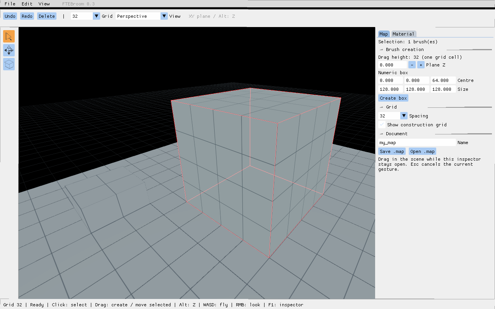

# FTEBroom 0.3 — редактор внутри FTE

[**Скачать Windows x64**](https://github.com/reyond9079/FTEBroom/releases/download/v0.3.0/FTEBroom-0.3-Windows-x64.zip) · [English](README.md)

Самостоятельный проект на FTE Quake, csaddon и Dear ImGui. Здесь нет исходников Qt-приложения TrenchBroom. Компоновка повторяет привычную схему редактора: меню и панель сверху, инструменты слева, инспектор справа, строка состояния снизу. Это экспериментальная версия, ещё не полный перенос ReyondBroom и не пиксельно точная копия TrenchBroom.



## Запуск

Скачайте ZIP по ссылке выше, полностью распакуйте и запустите **Launch-FTEBroom.cmd**. При каждом запуске выберите **Quake III Arena**, вставьте полный путь к **baseq3** и нажмите **Load resources and start**. Последний путь запоминается локально. Ресурсы Quake в сборку не входят. Игра и настройки обычной установки не изменяются.

Пакет содержит движок из закреплённых исходников с исправлением метаданных, плагин ImGui, csaddon, стартовую сцену, лицензии и исходники. В этой сборке отключены Ogg и статические голосовые кодеки. Проверена Windows x64/OpenGL на RTX 4060 Laptop GPU.

## Управление

По умолчанию выбран инструмент **Smart** со стрелкой:

- Один клик по брашу выделяет его. Порог протягивания — четыре пикселя.
- Протягивание по пустому месту или невыделенной поверхности создаёт коробку. Начальная высота берётся с поверхности, либо из **Plane Z**, если под курсором ничего нет.
- Протягивание уже выделенного браша перемещает его. Инструмент Move позволяет сразу двигать и невыделенный браш. Box всегда создаёт при протягивании.
- Обычно создание/перемещение идёт по **XY**. Зажатый **Alt** ограничивает перемещение осью **Z**. После отпускания Alt движение продолжается по XY с текущего места. При создании Alt регулирует высоту коробки.
- **Escape** отменяет текущий предпросмотр. Отпускание ЛКМ фиксирует одну операцию истории.
- Протягивание **ПКМ** поворачивает камеру; **WASD** перемещает её, когда курсор находится в сцене, без удерживания ПКМ. При вводе текста и открытых диалогах движение блокируется. Пока курсор ограничен границами окна.
- **F1** скрывает/показывает инспектор. При открытом инспекторе инструменты сцены продолжают работать. Нажатия внутри интерфейса не передаются сцене.
- **Ctrl+Z / Ctrl+Y** — Undo/Redo; Delete — удаление. История теперь использует время редактора, чтобы отдельные действия не сливались при остановленном игровом времени.

Перемещается браш под курсором; групповой трансформации пока нет. Диалоги сохранения/открытия намеренно блокируют сцену до ответа.

## Сетка и инспектор

Шаг сетки задаётся сверху, в **View → Grid size**, либо в **Map → Grid → Spacing**: 1, 2, 4, 8, 16, 32, 64, 128. Флаг отображения скрывает только сетку, привязка остаётся. На гранях брашей сетка имеет выбранный шаг и не изменяет UV текстур. На вспомогательной плоскости минимальный визуальный шаг равен 8. Пока слой на поверхностях ограничен 4096 ближайшими world-брашами в пределах 4096 единиц от камеры.

При протягивании высота нового браша равна одной ячейке сетки; Alt позволяет изменить её. Map содержит Plane Z, числовые координаты/размеры коробки, счётчик выделения и файловые команды. Material содержит список текстур и шейдеров, фильтр и предпросмотр. Клик выбирает материал для новых брашей. Сверху выбираются перспектива и X/Y/Z. В боковых видах XY соответствует видимой горизонтальной оси; Alt меняет высоту.

## Ресурсы Quake 3

Доступен профиль **Quake III Arena (Valve 220)**. PK3 и отдельные файлы из baseq3 подключаются только для чтения. Ресурсы редактора имеют более высокий приоритет. Шейдеры из `scripts/` и текстуры из `textures/` индексируются; изображения загружаются на видеокарту по мере использования. Вложенные пути текстур поддерживаются и в PK3 без записей о папках. Предпросмотр шейдера использует `qer_editorimage`, если он указан; отображение в сцене выполняет FTE.

Сменить путь можно в **File → Game / resources...**. Он сохраняется в `ftebroom-project.txt` рядом с приложением. Этот личный файл и игровые ресурсы не следует включать в распространяемые сборки.

Сохранение использует текстурные оси Valve 220. Нужен компилятор с поддержкой варианта Quake 3 Valve 220. Компиляция BSP, запуск игры и полный браузер определений сущностей Q3 пока не добавлены. Проверки ресурсов выполнены на собственных тестовых файлах; полный набор оригинальной baseq3 предстоит проверить пользователю.

## Файлы

Имя: латиница, цифры, `_`, `-`. **Save .map** записывает `ftebroom/maps/<имя>.map` после подтверждения перезаписи. **Open .map** после подтверждения открывает файл, теряя несохранённые изменения. Работайте с копиями: ещё нет учёта несохранённых правок, восстановления после сбоя и полной сохранности всех свойств Q2/Q3 при редактировании.

## Что проверить в 0.3

1. При открытом инспекторе кликните по полу, затем по пустому месту. Протяните по полу для создания браша. Один клик ничего не должен создавать.
2. Переместите выделенный браш: высота должна сохраниться. Зажмите Alt и протяните вверх/вниз: X/Y не меняются. Отпустите Alt в ходе жеста — проверьте отсутствие скачка.
3. Начните движение и нажмите Escape: геометрия должна остаться прежней.
4. Сделайте несколько отдельных действий и проверьте Undo/Redo по одному действию.
5. Поменяйте шаг в панели и меню View; проверьте привязку и переключатель видимости сетки.
6. Переключите F1. Инспектор не должен блокировать сцену, а редактирование его полей не должно двигать или создавать браши.
7. Сохраните/откройте тестовую карту, отмените диалог и повторите с подтверждением. Проверьте попадание указателя при масштабе Windows.

Автотесты проверяют обработку жестов, ограничения осей, отмену, историю и полные записи граней. Проверка реального ввода/фокуса и масштаба остаётся ручной.

## Сборка

Нужны Git, PowerShell, MSYS2 в `C:/msys64`: MinGW64 GCC/G++/make/zlib/libpng/libjpeg-turbo и стандартные инструменты MSYS.

```powershell
./scripts/build-windows.ps1
./scripts/smoke-windows.ps1 -Bundle ./out/FTEBroom-Windows-x64
```

Скрипт собирает движок, компилятор, csaddon и плагин. Параметр `-Engine <путь>` позволяет подставить другой движок, который должен отдельно пройти автотест. Результат: `out/FTEBroom-Windows-x64`.

[Архитектура](ARCHITECTURE.ru.md) · [Проверки](TESTING.ru.md) · [Лицензии](THIRD-PARTY.md). Новый код GPL-2.0-or-later, ImGui — MIT.

Fracture, Perforate, Bevel, Bullet Settle, массивы, браузеры сущностей/материалов, несколько одновременных видов и Linux-пакет остаются следующими этапами.
