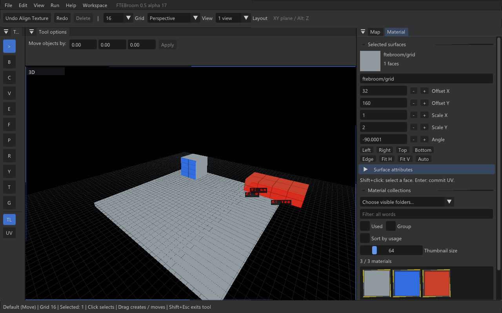

# FTEBroom — редактор карт на движке FTE

[**Скачать для Windows x64 · 0.5.0-alpha.17**](https://github.com/reyond9079/FTEBroom/releases/download/v0.5.0-alpha.17/FTEBroom-0.5.0-alpha.17-Windows-x64.zip) · [English](README.md)

Независимый редактор на FTE Quake, csaddon и Dear ImGui: сцена в движке, постоянный инспектор, меню и панель инструментов, до четырёх перспективных/ортографических видов. Сейчас поддерживается Quake III Arena с Valve 220-развёрткой брашей и патчами Quake 3.

**Экспериментальная Windows-сборка.** Добавлены тёмная тема, перемещаемые и растягиваемые панели, масштабирование шрифтов и сохранение раскладки. Инструменты alpha.16 остаются доступны. Вся спецификация ещё не завершена.

[**Настройка интерфейса и проверки**](docs/alpha17.ru.md) · [Геометрические инструменты](docs/alpha16.ru.md) · [**Полный список проверок**](docs/checks-alpha16.ru.md) · [Спецификация](docs/roadmap.ru.md)

## Возможности

- Тёмная палитра, закрепляемые и растягиваемые панели и вкладки, масштаб интерфейса 100–200%, сохранение, блокировка и сброс раскладки.

- Quake 3, baseq3, PK3, текстуры и шейдеры; игровые ресурсы подключаются только для чтения.
- Навигация по каталогам в Open/Save As, защита несохранённых изменений, MAP, автосохранение, Undo/Redo.
- WASD/QX, обзор мышью, orbit/pan, сохранённые позиции камеры, ортографические виды, связанные камеры и разделители.
- Сетка 0.125–256, привязка, отображение на поверхностях и фоне, настройка прозрачности.
- Выделение брашей, граней, патчей и точечных сущностей; выбор по глубине, рисование выделения, группы, размеры и заблокированные объекты.
- All/Invert/Siblings/Touching/Inside/Tall и выбор по строке MAP.
- Создание коробок, перемещение смешанного выделения, независимые копии вложенных групп/браш-сущностей, Delete и буфер MAP.
- Браузер материалов с каталогами, поиском и used-фильтром; замена/выделение по материалу, UV, атрибуты, Fit/выравнивание и перенос текстуры.
- Поворот/отражение, Rotate с переносимым центром, шагом угла и Texture Lock.
- Extrude через Shift-драг; Split через Shift+Ctrl; Stamp через Shift+Ctrl+Alt. Предпросмотр на сцене, Escape и один Undo.
- Clip с двумя/тремя точками, выбором стороны и прозрачной отбрасываемой частью. Расширенная переделка Clip ещё впереди.

## Запуск

Полностью распакуй ZIP и запусти **Launch-FTEBroom.cmd**. Выбери Quake III Arena, укажи **baseq3** и загрузи ресурсы. Игровые данные не включены; редактор не записывает изменения в baseq3.

Для новых операций запусти **Launch-Checks.cmd → B**. Работай на копиях карт. [Общий чек-лист](docs/checks-alpha16.ru.md) включает новые функции, регрессионные проверки, настоящий буфер обмена и масштаб интерфейса Windows.

## Управление

Клик выделяет; драг выбранного объекта перемещает. Без выделения драг по пустому месту создаёт коробку толщиной в ячейку. Обычно движение идёт по XY; Alt ограничивает его осью Z. Shift-клик выбирает грань, Shift-драг целиком выделенного браша меняет его размер. В 2D захватывай ребро проекции грани.

Ctrl-драг дублирует, Ctrl+D создаёт копию на месте. R — Rotate, C — Clip. Escape отменяет жест, Shift+Escape выключает модальный инструмент. Delete удаляет, Ctrl+Z/Ctrl+Y — Undo/Redo. F1 восстанавливает постоянный инспектор. При вводе текста камера не двигается.

Колесо по умолчанию меняет сетку; в Preferences можно перейти на Ctrl+Alt+колесо. В Material клик по текстуре применяет её к выделению. Там же настраиваются смещения, масштабы и угол. Отрицательный ненулевой масштаб отражает текстуру; поворот сохраняет существующий перекос UV-осей.

## Ограничения

Полный паритет ещё впереди: CSG, редактирование вершин/рёбер/граней, Scale/Shear, построение по точкам, примитивы, определения сущностей, полноценные слои/связанные группы, контрольные точки патчей, Sweep и UV-редактор. Часть кнопок — заготовки. История центров Rotate и отдельные уточнения браузера материалов тоже пока не реализованы.

MAP использует Valve 220 и патчи Quake 3: нужен совместимый внешний компилятор. Интеграция сборки/запуска карты и Linux-пакет не входят в этот выпуск. Проверена Windows x64/OpenGL на NVIDIA RTX 4060 Laptop GPU.

Сборка: `scripts/build-windows.ps1`; инструкции и зависимости — в [English README](README.md#build). См. [архитектуру](ARCHITECTURE.md), [проверки](TESTING.md) и [лицензии](THIRD-PARTY.md). Сохраняй исходники и уведомления сторонних проектов при распространении.
