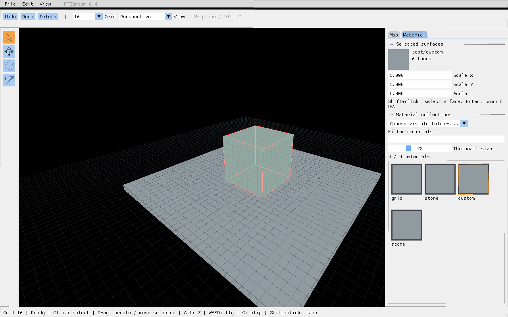
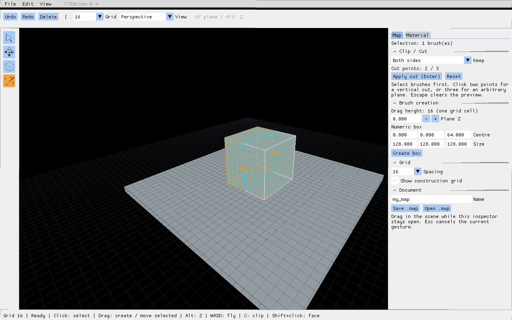

# FTEBroom — редактор внутри FTE

[**Windows preview 0.5.0-alpha.5 — сетка и привязка**](https://github.com/reyond9079/FTEBroom/releases/download/v0.5.0-alpha.5/FTEBroom-0.5.0-alpha.5-Windows-x64.zip)

[**Скачать Windows x64**](https://github.com/reyond9079/FTEBroom/releases/download/v0.4.0/FTEBroom-0.4-Windows-x64.zip) · [English](README.md)

Самостоятельный проект на FTE Quake, csaddon и Dear ImGui. Здесь нет исходников Qt-приложения TrenchBroom. Компоновка повторяет привычную схему редактора: меню и панель сверху, инструменты слева, инспектор справа, строка состояния снизу. Это экспериментальная версия, ещё не полный перенос ReyondBroom и не пиксельно точная копия TrenchBroom.


Обновление alpha.5: сетка 0,125–256, отключение привязки, горячие клавиши, настройки колеса и прозрачности, Clip на наклонной плоскости. [Описание и проверка](docs/task-0.5.ru.md).

Предыдущее обновление alpha.4: исправлен Del, добавлены именованные транзакции, история выделения, объединение быстрых сдвигов и отмена с сохранением Redo. [Описание и проверка](docs/task-0.4.ru.md).

Предыдущее обновление alpha.3: прозрачное отсечение, перенос без исходного изображения, модель документа, защита сохранения и автокопии. [Описание и проверка](docs/task-0.3.ru.md).

## Предыдущий этап: задача 0.2

Переключение режимов, новая панель, каскад Escape для Clip, снятие выделения с Undo, числовое перемещение брашей и настройка прежнего перетаскивания. **Остальные новые режимы пока только каркасы, без редактирования геометрии.** [Описание и проверка](docs/task-0.2.ru.md).


Задача 0.1 принята 20.10.2026. [Сочетания клавиш](docs/shortcuts.md) и [исходная спецификация](docs/roadmap.ru.md).

## Запуск

Скачайте ZIP по ссылке выше, полностью распакуйте и запустите **Launch-FTEBroom.cmd**. При каждом запуске выберите **Quake III Arena**, вставьте полный путь к **baseq3** и нажмите **Load resources and start**. Последний путь запоминается локально. Ресурсы Quake в сборку не входят. Игра и настройки обычной установки не изменяются.

Пакет содержит движок из закреплённых исходников с исправлением метаданных, плагин ImGui, csaddon, стартовую сцену, лицензии и исходники. В этой сборке отключены Ogg и статические голосовые кодеки. Проверена Windows x64/OpenGL на RTX 4060 Laptop GPU.

## Управление

По умолчанию выбран инструмент **Default (Move)** со стрелкой:

- Один клик по брашу выделяет его. Порог протягивания — четыре пикселя.
- Протягивание по пустому месту или невыделенной поверхности создаёт коробку. Начальная высота берётся с поверхности, либо из **Plane Z**, если под курсором ничего нет.
- Протягивание уже выделенного браша перемещает его. Инструмент Move позволяет сразу двигать и невыделенный браш. Box всегда создаёт при протягивании.
- Обычно создание/перемещение идёт по **XY**. Зажатый **Alt** ограничивает перемещение осью **Z**. После отпускания Alt движение продолжается по XY с текущего места. При создании Alt регулирует высоту коробки.
- **Escape** отменяет текущий предпросмотр. Отпускание ЛКМ фиксирует одну операцию истории.
- Протягивание **ПКМ** поворачивает камеру; **WASD** перемещает её, когда курсор находится в сцене, без удерживания ПКМ. При вводе текста и открытых диалогах движение блокируется. Пока курсор ограничен границами окна.
- **F1** возвращает постоянный интерфейс и больше не скрывает инспектор. После открытия другой карты интерфейс восстанавливается автоматически. При открытом инспекторе инструменты сцены продолжают работать. Нажатия внутри интерфейса не передаются сцене.
- **Ctrl+Z / Ctrl+Y** — Undo/Redo; Delete — удаление. История теперь использует время редактора, чтобы отдельные действия не сливались при остановленном игровом времени.

Перемещается браш под курсором; групповой трансформации пока нет. Диалоги сохранения/открытия намеренно блокируют сцену до ответа.

## Сетка и инспектор

Сетка поддерживает шаг 0,125–256: панель сверху, инспектор и **View → Grid**. Клавиши 1–9 выбирают 1–256; +/− проходят весь диапазон. **0** переключает видимость, **Alt+0** — привязку. В инспекторе доступна прозрачность. Слишком плотные линии отображаются реже, без изменения фактического шага привязки. UV и рисунок текстуры не меняются.

Обычное колесо по умолчанию работает как раньше: вверх — крупнее, вниз — мельче. Отключите **Plain wheel changes grid (legacy)** в Preferences, чтобы менять сетку только через Ctrl+Alt+колесо (вниз — крупнее). Там же доступна инверсия. Над панелями колесо прокручивает интерфейс. **Plane Z** задаёт высоту плоскости построения при промахе по геометрии. Полная фоновая сетка 2D остаётся задачей 1.2.

При протягивании высота нового браша равна одной ячейке сетки; Alt позволяет изменить её. Map содержит Plane Z, числовые координаты/размеры коробки, счётчик выделения и файловые команды. Material содержит сетку миниатюр с регулируемым размером, текстовый фильтр и список каталогов **Choose visible folders**. Сверху показан материал выделенных поверхностей. Клик сразу применяет материал к выделенному брашу или грани, а также выбирает его для новых брашей. Сверху выбираются перспектива и X/Y/Z. В боковых видах XY соответствует видимой горизонтальной оси; Alt меняет высоту.

## Текстуры и UV



Обычный клик выделяет браш целиком, **Shift+клик** — одну грань. В Material доступны **Scale X**, **Scale Y** и **Angle**. Enter или уход из поля фиксирует изменение; оно отменяется через Undo. Масштаб 2 увеличивает текстуру вдвое. Отрицательные ненулевые значения отражают её; модуль меньше 0.001 запрещён. Угол задаётся в градусах. Смещения текстур сохраняются. Изменение угла строит перпендикулярные оси от проекции грани, поэтому косые UV импортированной карты при этой операции нормализуются. Для разнородного выделения выводится предупреждение; редактируемое значение применяется ко всем выделенным граням.

## Clip / Cut

Выделите браш и нажмите **C** либо четвёртую кнопку слева. Два клика задают линию разреза: в перспективе и виде сверху она продолжается по Z, в видах X/Y — вдоль соответствующей оси взгляда. Третья точка задаёт произвольную плоскость; четвёртый клик начинает новую. Точки привязаны к сетке.

В **Map → Clip / Cut** выберите **Both sides** (обе половины), **Front (blue)** (синяя сторона) либо **Back (orange)** (оранжевая). Предпросмотр отображается в сцене. **Enter / Apply cut** применяет разрез; **Escape / Reset** сбрасывает точки. Новые грани получают текущий материал для новых брашей. Один Undo отменяет весь разрез. Касание, разрез вне браша и точки на одной прямой не портят геометрию. Поддерживаются выпуклые браши до 63 исходных плоскостей; patches не разрезаются. Каждый выделенный браш обрабатывается отдельно.



## Ресурсы Quake 3

Доступен профиль **Quake III Arena (Valve 220)**. PK3 и отдельные файлы из baseq3 подключаются только для чтения. Ресурсы редактора имеют более высокий приоритет. Шейдеры из `scripts/` и текстуры из `textures/` индексируются; изображения загружаются на видеокарту по мере использования. Вложенные пути текстур поддерживаются и в PK3 без записей о папках. Предпросмотр шейдера использует `qer_editorimage`, если он указан; отображение в сцене выполняет FTE.

Сменить путь можно в **File → Game / resources...**. Он сохраняется в `ftebroom-project.txt` рядом с приложением. Этот личный файл и игровые ресурсы не следует включать в распространяемые сборки.

Сохранение использует текстурные оси Valve 220. Нужен компилятор с поддержкой варианта Quake 3 Valve 220. Компиляция BSP, запуск игры и полный браузер определений сущностей Q3 пока не добавлены. Проверки ресурсов выполнены на собственных тестовых файлах; полный набор оригинальной baseq3 предстоит проверить пользователю.

## Файлы

Имя: латиница, цифры, `_`, `-`. **Save .map** записывает `ftebroom/maps/<имя>.map` после подтверждения перезаписи. **Open .map** после подтверждения открывает файл, теряя несохранённые изменения. Работайте с копиями: ещё нет учёта несохранённых правок, восстановления после сбоя и полной сохранности всех свойств Q2/Q3 при редактировании.

## Что проверить в 0.4

1. При открытом инспекторе кликните по полу, затем по пустому месту. Протяните по полу для создания браша. Один клик ничего не должен создавать.
2. Переместите выделенный браш: высота должна сохраниться. Зажмите Alt и протяните вверх/вниз: X/Y не меняются. Отпустите Alt в ходе жеста — проверьте отсутствие скачка.
3. Начните движение и нажмите Escape: геометрия должна остаться прежней.
4. Сделайте несколько отдельных действий и проверьте Undo/Redo по одному действию.
5. Поменяйте шаг в панели; проверьте привязку и переключатель видимости сетки.
6. Нажмите F1 и откройте другую карту: интерфейс должен остаться видимым. Инспектор не должен блокировать сцену, а редактирование его полей не должно двигать или создавать браши.
7. Сохраните/откройте тестовую карту, отмените диалог и повторите с подтверждением. Проверьте попадание указателя при масштабе Windows.

8. Прокрутите колесо над сценой и над браузером материалов: сетка меняется только над сценой.
9. Shift+кликом выберите грань, назначьте материал, масштабы 2 и 4 и угол 90. Остальные грани должны остаться прежними. Проверьте Undo/Redo.
10. Нажмите C на выделенном браше, поставьте точки, проверьте три режима сохранения сторон, отмену и Undo/Redo.
11. Подключите настоящую baseq3, отфильтруйте каталоги, прокрутите миниатюры и проверьте показ материала выделенного браша.

Автотесты проверяют обработку жестов, ограничения осей, отмену, историю и полные записи граней. Проверка реального ввода/фокуса и масштаба остаётся ручной.

## Сборка

Нужны Git, PowerShell, MSYS2 в `C:/msys64`: MinGW64 GCC/G++/make/zlib/libpng/libjpeg-turbo и стандартные инструменты MSYS.

```powershell
./scripts/build-windows.ps1
./scripts/smoke-windows.ps1 -Bundle ./out/FTEBroom-Windows-x64
```

Скрипт собирает движок, компилятор, csaddon и плагин. Параметр `-Engine <путь>` позволяет подставить другой движок, который должен отдельно пройти автотест. Результат: `out/FTEBroom-Windows-x64`.

[Архитектура](ARCHITECTURE.ru.md) · [Проверки](TESTING.ru.md) · [Лицензии](THIRD-PARTY.md). Новый код GPL-2.0-or-later, ImGui — MIT.

Fracture, Perforate, Bevel, Bullet Settle, массивы, браузеры сущностей/материалов, несколько одновременных видов и Linux-пакет остаются следующими этапами.
