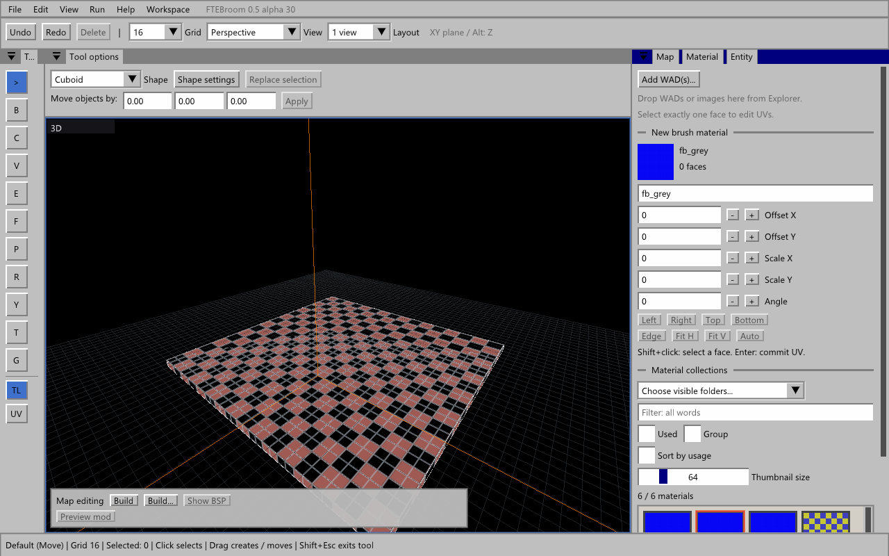

# Темы, интеграция с Windows и текстурированные модели

[English](alpha30.md)

## Интерфейс

**View → Interface theme → Modern Dark / Windows 95 / 98** переключает тёмную и ретро-тему. У ретро-темы серые панели, белые утопленные поля, объёмные прямоугольные кнопки и синие заголовки. Выбор сохраняется вместе с параметрами интерфейса и не сбрасывает расположение панелей. Для изменения размеров отключите блокировку панелей. У границ, углов и разделителей появляются соответствующие курсоры Windows; над текстовыми полями — текстовый курсор.

Исправлена отрисовка треугольников сглаживания: пропадавшие фрагменты границ кнопок и полей теперь выводятся независимо от порядка вершин. Ретро-рамки рисуются ровными полосами, привязанными к пикселям.

## WAD и импорт изображений — профиль Quake 1

На вкладке **Material** нажмите **Add WAD(s)...** и выберите один или несколько WAD2. Можно перетащить WAD из Проводника в редактор. Пути добавляются в сохраняемый список WAD профиля. Автоматическое чтение WAD из игры, мода и PAK остаётся доступным. Профили Q3 продолжают использовать свои текстуры и шейдеры.

Перетащите изображение на панель **Material / браузер текстур**. В окне импорта задайте имя текстуры и WAD назначения. **Choose / create WAD...** позволяет выбрать существующий файл или создать новый. Нажмите **Import**. Для нескольких изображений окно открывается последовательно.

- Форматы: PNG, JPEG, BMP, GIF, TIFF и TGA RGB/RLE. Для анимаций используется первый кадр.
- Каждый размер округляется вверх до степени двойки в пределах 16–512 пикселей. Пропорции могут измениться: при необходимости подготовьте исходник заранее.
- Используется загруженная палитра Quake, без fullbright-индексов 224–255. Прозрачность накладывается на чёрный фон. Создаются четыре mip-уровня.
- Имя: до 15 латинских букв, цифр, подчёркиваний или дефисов. Совпадающее имя, включая другой регистр, не перезаписывается.
- Старые записи WAD сохраняются. Перед заменой файла рядом создаётся резервная копия `.ftebroom-*.bak`.
- Назначение импорта — отдельный WAD2 на диске. Чтение WAD внутри PAK поддерживается, но импорт изображений прямо в упакованный WAD пока недоступен.
- Запускайте редактор и Проводник с одинаковыми правами: Windows блокирует перенос файлов в приложение, запущенное от администратора.

## Модели энтити

Поддержаны MDL и MD3 с несколькими поверхностями из ресурсов игры/мода, включая PAK/PK3. Для Quake 3 и **When the sky went dark** доступны MD3. У профиля мода его ресурсы также подключаются для миниатюр. Исправлена загрузка встроенных палитровых скинов MDL. Поддерживаются внешние скины MDL, картинки шейдеров MD3 и явно заданные `.skin`.

Связь класса с моделью должна быть в определениях энтити либо встроенной подсказке. Редактор не запускает `progs.dat`, чтобы угадать произвольные связи. Миниатюры показывают первую позу без анимации. Если модель/картинка отсутствует или формат не поддерживается, остаётся значок габаритов. Для шейдеров используется картинка предпросмотра, а не полный динамический эффект.

## Перемещение

Во время движения исходный браш скрыт, видимый браш сразу следует за мышью. Отпускание подтверждает одну операцию, Escape возвращает исходное положение, Undo/Redo продолжают работать. При дублировании оригинал намеренно остаётся.

## Обновления

Начиная с alpha.30 редактор при запуске проверяет опубликованные релизы этого репозитория, включая новые alpha-версии. Новая Windows-сборка скачивается в фоне и проверяется по SHA-256. Статус и повторная проверка — **Help → Updates**.

Установка ждёт обычного закрытия редактора: принудительного перезапуска нет. После следующего запуска сохраняются тема, расположение панелей, пути профилей и документы. Изменённые пользователем CFG/WAD/определения из дистрибутива защищены манифестом. В `updates/` остаются копии предыдущих файлов; при ошибке установки выполняется откат. Ошибка сети не мешает работать со старой версией.

Первую alpha.30 нужно установить вручную: в предыдущих версиях обновляющего модуля нет. Папка редактора должна быть доступна для записи. Внешние папки игры и мода обновление не меняет.

## Что проверить

1. Обе темы, кнопки/поля/вкладки и края окон при масштабе 100%, 125%, 200%. Перезапуск должен сохранять тему, масштаб и расположение панелей.
2. Курсоры на границах, углах и разделителях; возвращение обычного курсора; ввод текста и управление камерой.
3. Quake 1: добавить несколько WAD, перетащить WAD из Проводника, найти/применить текстуры, перезапустить. Проверить прежние WAD из PAK.
4. Импорт PNG/JPEG/TGA в существующий и новый WAD. Проверить размеры, палитру, имя, резервную копию и сохранность старых текстур. Попробовать повторное имя и отмену.
5. Браузер энтити в Quake 1/LibreQuake, Q3 и профиле мода: текстуры MDL/MD3, размер миниатюр, поиск, пути моделей из определений и смена ресурсов.
6. Движение браша в 3D/2D без копии на исходном месте, Alt по вертикали, Escape, Undo/Redo, несколько объектов и дублирование.
7. Help → Updates: статус проверки. Когда выйдет следующий релиз — дождаться скачивания, сохранить карту, закрыть и открыть редактор; проверить версию и сохранность настроек/WAD/карт. Не откатывайте рабочую установку только ради этой проверки.
8. Открытие/сохранение карт, Build, MAP/BSP и вход/выход из режима мода в используемых профилях.
