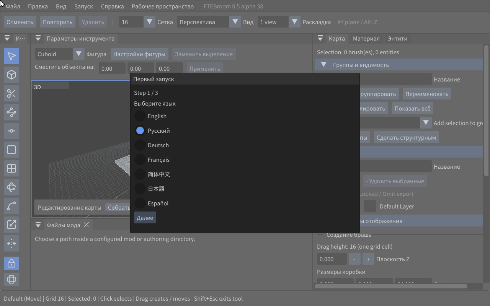

# Linux hotfix alpha.38

The bundled OFL font now supplies Latin and Cyrillic at every UI scale, without
Windows fonts. ImGui draws the Linux pointer, including resize/text cursors,
hides it during camera look and restores it afterwards.

The editor no longer probes its raw ELF plugin as a ZIP. The old warning did not
mean the plugin was damaged. Empty optional config.cfg/fte.cfg templates prevent
missing-config warnings on clean installations.

Linux-only hotfix; Windows remains alpha.37. Extract into a new directory and
copy your old settings. Do not replace your existing config.cfg/fte.cfg with
empty templates. See [Linux dependencies and limitations](linux.md).

## Test checklist

1. Russian in first-time setup and View; language persists after restart.
2. Russian labels and filenames at 100/125/150/175/200% font scale.
3. Visible cursor over menus, browsers and scene; resize/text cursor shapes.
4. Camera look hides the pointer; releasing the button restores it.
5. No plugin ZIP or missing config.cfg/fte.cfg startup warnings.
6. Open a map copy, select/move, Undo/Redo, Build and inspect BSP.

Automated Ubuntu 24.04/Xvfb regression checks Cyrillic glyphs at every scale,
cursor show/hide/restore and startup messages; rendered Russian UI is inspected.

