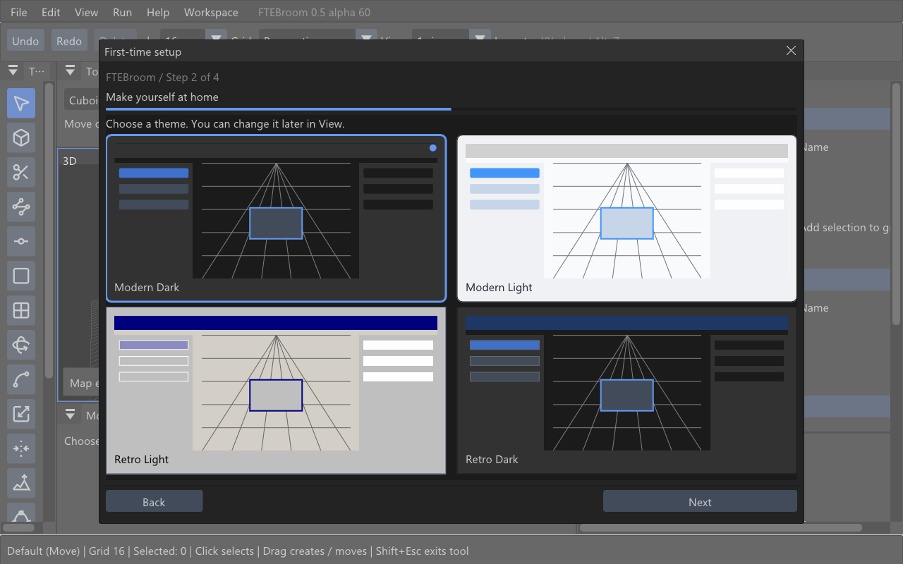

# Alpha 60: profile reload, first-time setup and display mode

## First-time setup

New installations use one four-step window: **Language → Theme → Game profile → Resources**. Its size and position stay the same between steps; the content scrolls when necessary. Back and Next remain in a fixed footer. Theme tiles preview the editor palette and apply immediately. Choose **Modern Dark**, **Modern Light**, **Retro Light** or **Retro Dark**. Your choice is saved and remains available under **View → Interface theme**. Existing theme IDs and saved preferences remain compatible.

## Fullscreen

Use **View → Fullscreen** to enter or leave desktop fullscreen. The window changes without restarting the renderer, reloading the map or discarding unsaved changes. The choice is saved separately from the map; new installations start windowed. Windows restores the previous window placement. Linux uses the desktop window manager's X11 fullscreen protocol (also used by the current XWayland build).

## FTE Custom rendering

Applying FTE Custom game resources enables `r_glsl_offsetmapping 1`. Embedded mod preview also receives this setting. Returning to another profile restores the previous editor value, rather than forcing a new value on Quake 1 or Quake 3. No mod configuration or GLSL source is edited. The material must contain a compatible height/normal mapping shader for this setting to produce a visible effect.

## Resource reload maintenance

Unchanged material metadata and entity definitions no longer trigger full MAP geometry-cache rebuilds whenever profile settings are applied. The Apply button no longer requests entity-definition loading twice. Changed metadata and different resource roots still invalidate the relevant caches.

A disposable copy of hotel02 reproduced a roughly one-minute stall after resource application in alpha.59; repeated application with the cache fix completed without that stall. That run did not reproduce a process crash, so this does not establish that every reported crash has been eliminated. Original map and mod files were not modified.

## What to check

1. In a fresh installation, visit all four setup steps, use Back, and confirm the window and footer do not jump. Try each theme tile and restart to verify the choice is retained.
2. Apply resource settings repeatedly with hotel02 open, including Current FTE default, Neutral studio and your custom GLSL file. Verify rendering, selection, unsaved changes and Undo remain intact.
3. Change a real resource folder or entity definition and confirm the browser reflects the new resources; the reload must not reuse obsolete metadata.
4. Toggle View → Fullscreen with an unsaved map, then return to windowed mode. Check mouse position, pane resizing, text input, thumbnails and the map. Restart to check the saved mode.
5. With FTE Custom game active, check `r_glsl_offsetmapping` is 1 and inspect compatible mod materials in MAP/BSP and mod preview. Switch to Quake 1/3 and verify their earlier setting is restored.

Automated coverage includes theme tile clicks, persistent theme selection, all setup-step bounds, fullscreen state/unchanged document revision, offset-mapping profile isolation, and repeated resource application. Linux UI testing uses Arch with Xvfb/Openbox; a real Wayland compositor still needs user confirmation.
