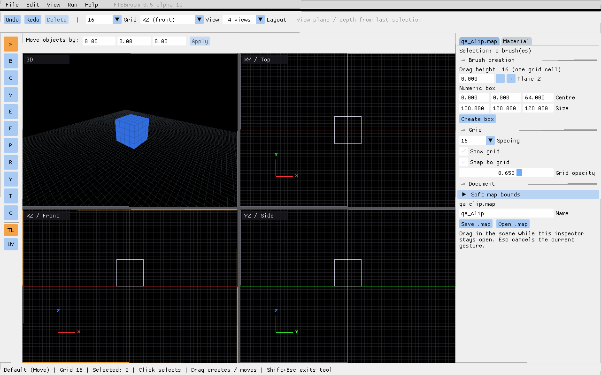
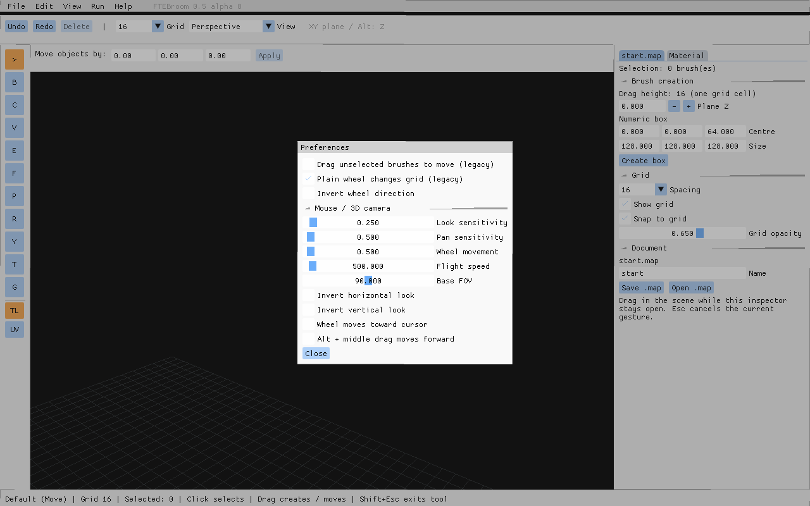
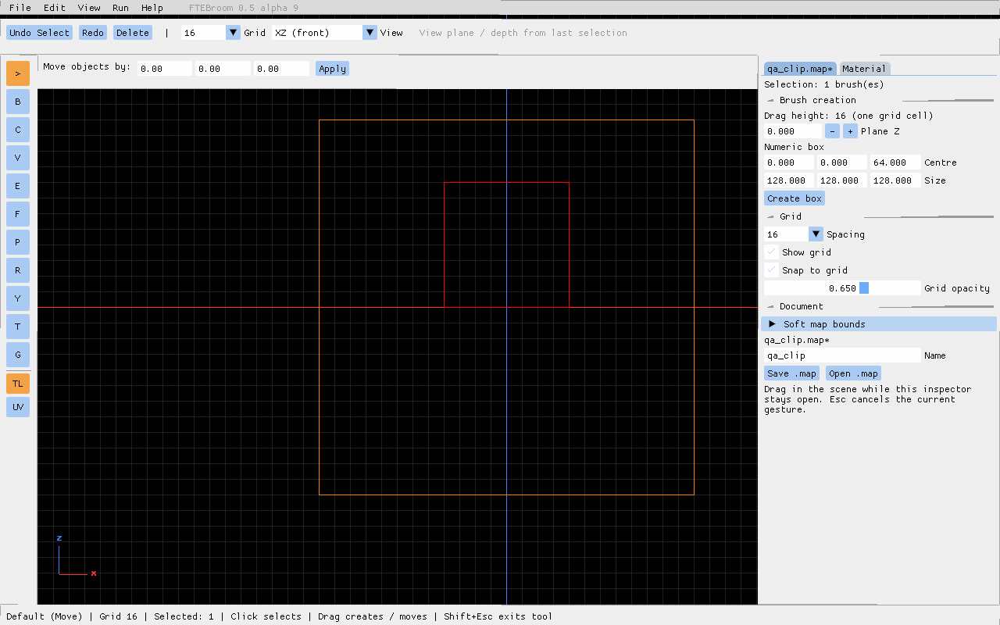
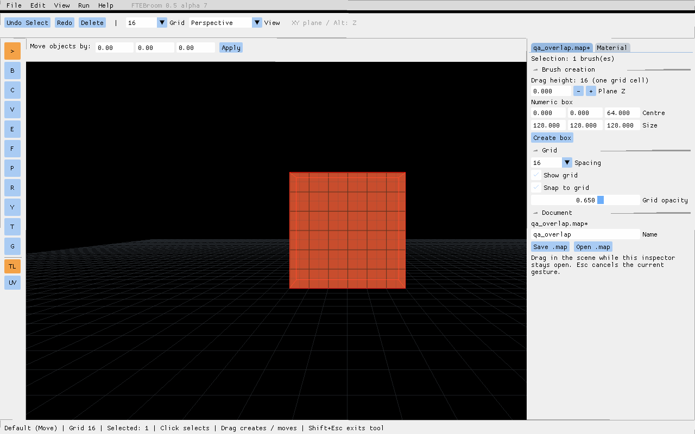
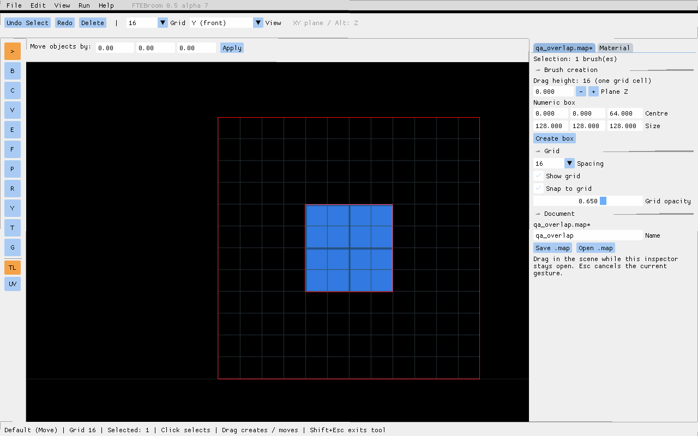
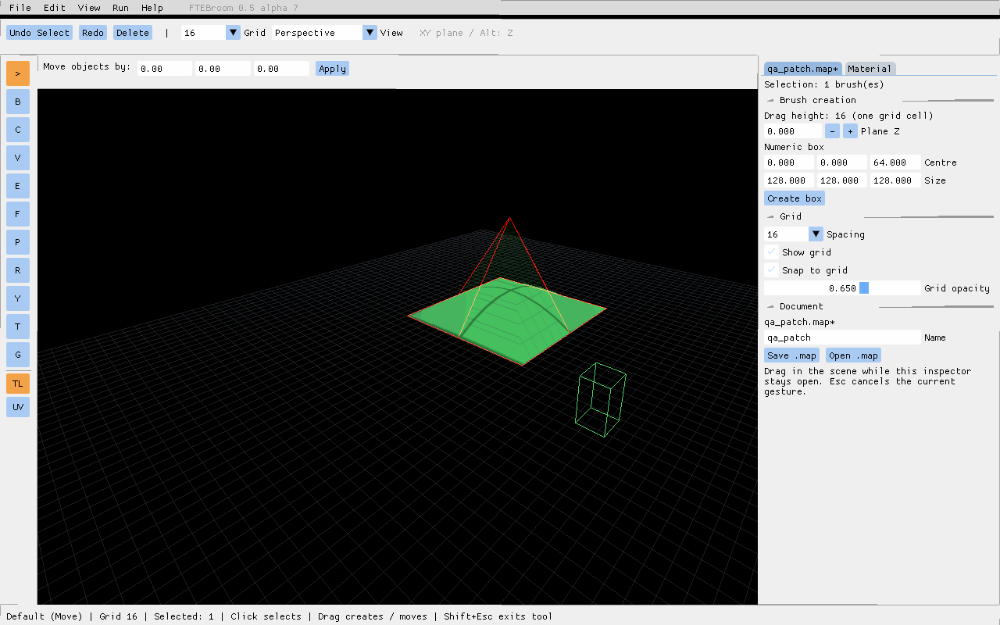
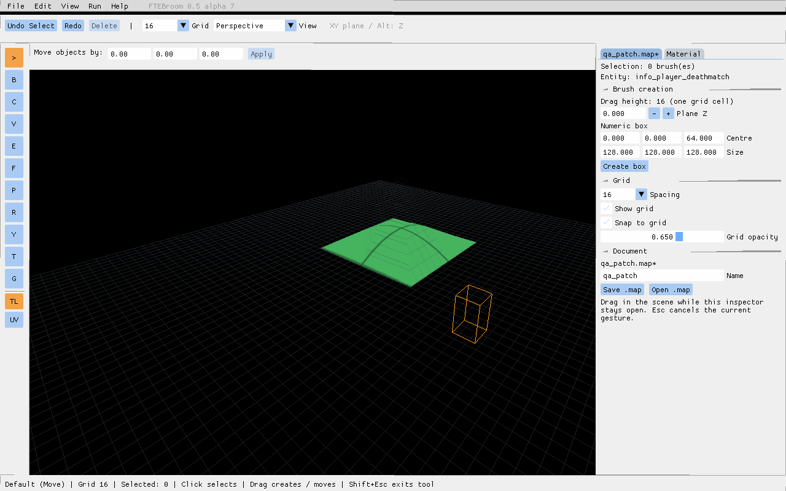
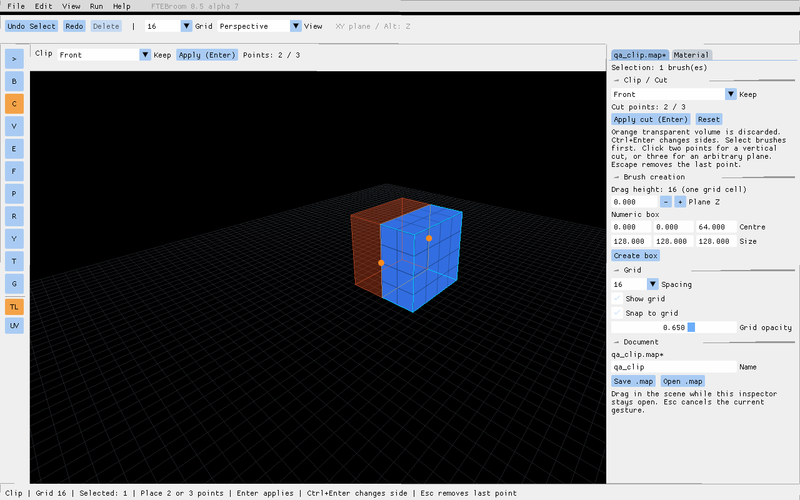

# Combined acceptance checklist — 0.5.0-alpha.11
[user manual](manual.md)

Extract the entire ZIP into a new folder. The following checks include the untested alpha.9/alpha.10 stages. Use the supplied scenes; no patch creation is required.

## New: surface grid and view-plane constraints

Use **Launch-Checks.cmd → 7** (four views).

1. Select the cube and drag it in XY, XZ and YZ. Check the other panes: the hidden coordinate must stay unchanged. Undo and Redo each movement.
2. Repeat while holding Alt from the start, then pressing/releasing Alt midway. Movement must remain smooth in the same 2D plane, without switching to Z or pausing.
3. Start dragging without Shift, move diagonally, then hold Shift. Only the dominant displayed axis should move. Move the pointer across the other axis: the locked axis must not change. Release Shift: both axes become available again. Test each plane, including vertical movement in XZ/YZ.
4. Shift+click a face without dragging: face selection must still work.
5. Create a brush by dragging empty space in each 2D pane. Its depth/thickness should match the last selected brush. Cancel a preview with Esc; no new brush should remain. Commit another and verify Undo/Redo.
6. Drag across a divider into another pane: the gesture must retain its original plane. Esc cancels; releasing commits once.
7. In perspective, move normally and with Alt: XY and Z rules must remain unchanged.
8. Inspect the grid on the cube in 3D. Change spacing, opacity, visibility; fly and rotate the camera, resize/maximize the pane. Lines must respond immediately and stay attached to surfaces.
9. Move, create, delete and Clip a brush, then Undo/Redo. No grid should remain at the old location or on deleted parts. During a drag the old brush must remain hidden; during Clip the discarded part remains translucent.
10. Open another map, including scene 3 with its ready-made patch. The previous map's grid must not remain. Save under a new name and reopen: geometry/materials must survive.
11. On your larger map compare responsiveness with grid on/off. Report map size, layout, window resolution, GPU and whether the camera was moving if performance is poor.

12. In each 2D view, activate Clip and place points in empty space around the selected cube. Points must follow both visible coordinates and the inherited depth; changing focus must not rotate the cut plane.

The complete earlier checklist follows.

## Scene 7 — multiple views (task 1.3)

Alpha.9 and alpha.10 have not been manually accepted yet. Run these checks in addition to all the existing sections below, especially scenes 4 and 6.

1. Run `Launch-Checks.cmd`, choose **7**: 3D top-left, XY top-right, XZ bottom-left, YZ bottom-right; the same blue cube appears in all four.
2. Set **Layout → 1 view**. Hover the scene and press Space: 3D → XY → XZ → YZ → 3D. Two views cycle only the right pane; three cycle only bottom-right XZ/YZ; four do not cycle.
3. Return to four views, click the cube once, then move between panes. The orange focus border follows the pointer; clicking the cube works in every pane.
4. Hover XZ and press Ctrl+Space to maximize; repeat to restore sizes/layout. Repeat for 3D and YZ.
5. Drag both dividers: no brushes are created. In the regular launcher, layout and ratios survive restarting. Diagnostic scenes intentionally do not save preferences.
6. Pan XY along X with the middle button: XZ follows along X. Check shared Z between XZ/YZ. The wheel in any 2D pane changes the shared zoom.
7. Select the cube, Ctrl+Shift+U: all 2D cameras center on selection at default zoom. Deselect and repeat: center is world origin.
8. In 3D, right-drag and WASD move only its camera; maximize/restore retains the viewpoint.
9. Move the cube in each 2D pane, Undo/Redo: all panes update. Drag across a divider: the gesture stays on its original plane. Escape cancels.
10. Select the cube, C, place two Clip points in XZ. Hover XY/YZ: cut plane and retained sides stay fixed. Ctrl+Enter changes retained side, Enter applies, Undo restores.
11. Open another map and resize the application: views and permanent UI remain usable. Space/Ctrl+Space inside text fields must not change views.

## Preparation

Extract the **entire alpha.11 ZIP** into a new directory. Close other FTEBroom windows, then run **Launch-Checks.cmd** next to Launch-FTEBroom.cmd. Choose scene **1–6** and wait about 10 seconds for the test map and camera to settle. The fixtures use bundled textures; no Quake 3 assets or patch creation are required. Close the editor between scenes. Restarting a scene restores its original contents, unless you explicitly saved over the bundled map.

Use only these disposable maps for destructive checks. To test saving, choose a new name such as `qa_result`, not the supplied `qa_*` name. The regular launcher still opens the ordinary editor/project workflow.

An overlapping view means that several separate objects occupy the same screen position. It does **not** require intersecting solids. Scene 1/2 contains a large red box in front of a small blue box, with a gap between them. The two camera presets look along the same axis.

## 1. Perspective: closest object

Choose **1** in the launcher. The View dropdown should say **Perspective**.

1. Click the centre of the red rectangle once, without dragging. Only the large red brush should be selected. The small blue brush behind it must not be selected through it.
2. Open the **Material** inspector tab: the selected material should be `ftebroom/qa_red`.
3. Press Escape, then Ctrl+Z: selection should clear and return. Ctrl+Y should clear it again.
4. Move the camera sideways with A/D, using RMB to adjust the viewing direction, until the blue brush is exposed beside the red one. Click the exposed blue surface: it should now select normally, with material `ftebroom/qa_blue`.

This is ordinary nearest-surface selection, not cycling through objects behind one another.

## 2. 2D: smaller projected face

Close the editor, launch checks again and choose **2**. View should say **XZ (front)**. You should see a small rectangle inside a large rectangle. These are the same separate boxes seen without perspective; the small one is behind the large one.

1. Click **inside the small rectangle**: only the small brush should be selected. Its material is `ftebroom/qa_blue`.
2. Click **inside the large rectangle but outside the small one**: the large brush should be selected. Its material is `ftebroom/qa_red`.
3. Repeat several times. Selection must follow the click, without moving or creating objects.
4. Test Ctrl+Z/Ctrl+Y for these selection changes.

The 2D rule chooses the smaller projected face under the cursor, even when that object is farther away. Wireframe appearance may not show material colours; the Material tab is the unambiguous check.

## 3. Curved patch and point entity

Choose **3**. The green curved sheet is a ready-made **patch** (a curved surface controlled by a grid of points), not a solid brush. The small wire box beside it is an `info_player_deathmatch` entity.

1. Click the middle of the green sheet: the patch should highlight. Click another visible part of the sheet; selection should remain on the patch.
2. Click empty space beside the sheet, without dragging: no object should be created.
3. Select the sheet and test Escape, Ctrl+Z and Ctrl+Y: selection should clear, return and clear.
4. Click the small wire entity box: its bounds should highlight and the inspector should display **Entity: info_player_deathmatch**.
5. Test Escape, Ctrl+Z and Ctrl+Y for that entity selection too.
6. Switch View to **XZ (front)** or **XY (top)** and back to **Perspective**. The panel must remain usable and the scene must remain intact.

There is **no patch creation tool in this release**. You do not need to build the sheet yourself. Patch control-point editing, entity movement/properties and accurate picking of an entity's model mesh are not part of these stages. The generic brush selection counter may count a selected patch as one brush; this is not a request to convert it.

## 4. Clip and core editing

Choose **4**. There is one blue cube.

1. Click the cube; press **C**. Clip should activate and be visible on the toolbar.
2. Place two different points on the visible top face, making a line across its interior. Do not put both points on the same edge. A line parallel to the cube's X or Y edge is the simplest first cut.
3. Set **Keep → Front**, then **Back**. The side that will be removed should be translucent; changing the side should switch that preview. For **Both sides**, both halves are retained.
4. Press **Ctrl+Enter** to switch the retained side, then **Enter** (or Apply) to commit. Check that the preview agrees with the result.
5. Ctrl+Z should restore the whole cube; Ctrl+Y should restore the cut. Repeat with **Both sides**: there should be two separately selectable solid halves.
6. Escape exits Clip after clearing its points. Move one half away: the cut should be a closed face, with no hole. During dragging, the original-position copy must not remain visible. Undo the move.
7. Undo back to the whole cube. In the Material tab set **Scale X = 2**, **Scale Y = 4**, **Angle = 30** for the whole cube. Cut it again. Original outer surfaces must keep their mapping; the new cut surface uses the current material with default mapping. Undo/Redo must preserve the result.
8. Try a diagonal cut through the interior. Both halves must remain closed and selectable.
9. Try a line that only touches an outside edge, and a line completely outside the cube. The cube must stay unchanged; no thin duplicate or broken object should appear. Invalid cuts may be rejected.
10. Select a whole half and press **Delete** with the pointer in the scene and no text field being edited. Only that half should disappear. Ctrl+Z restores it; Ctrl+Y deletes it again.
11. Move a whole brush normally: X/Y change, height stays fixed. With Alt held, only height changes. Escape during a drag should cancel it.
12. Drag in empty space to create a brush. Its initial height should equal one grid step. Undo/Redo should remove/restore it.
13. Change the grid with the wheel and the Grid dropdown. Check visible grid lines on surfaces. With default settings the wheel changes grid size.
14. Save under **qa_result**, open another supplied `qa_*.map`, then reopen qa_result. Check the cut geometry, textures and scales. The permanent panel should remain visible after each map load.
15. Finally open one of your **copied** working maps with your Quake 3 project. Check textures, selecting/moving/clipping a simple brush, Undo/Redo, save under a new name and reopen.

## 5. Camera: navigation, capture and saved views

Choose **5**. This scene contains a blue cube and remembers its own camera position. Keep the pointer over the scene unless a step specifically asks you to use the UI.

1. Hold RMB and look around. Continue moving in one direction beyond the window edge: rotation must continue. Release RMB: the cursor should return to its starting position. Look up/down: the view must not flip or roll. Escape should release capture too.
2. Hold WASD without a mouse button: movement follows the view. Aim upward and hold W: the camera must rise. Q rises along world Z; X descends regardless of viewing angle. Release each key: movement stops.
3. Compare W alone, Shift+W and Alt+W: the latter two should be twice and half as fast. Hold RMB and scroll: flight speed changes gradually; check its value under **Edit → Preferences → Flight speed**.
4. Point at the visible cube and hold Alt+RMB. Orbit around that surface point: it should remain the pivot, rather than the camera spinning in place. Scroll while still orbiting: radius changes without crossing through the pivot. Try orbiting above and below it; the view must not flip.
5. Start Alt+RMB over empty space: the fallback pivot lies ahead of the camera, so orbit still works. This fallback does not create an object or selection.
6. Hold the middle button and drag: the view pans sideways/up/down without rotation. In Preferences enable **Alt + middle drag moves forward**, then compare Alt+middle vertical dragging with ordinary middle dragging. Disable it afterwards.
7. Shift+wheel changes zoom; Ctrl+Alt+Z restores the base field of view. Change **Base FOV** in Preferences and repeat the reset. Motion and look should be slower while zoomed in.
8. By default plain wheel still changes Grid. Disable **Plain wheel changes grid (legacy)** in Preferences: plain wheel now moves forward/back; Ctrl+Alt+wheel still changes Grid. Enable **Wheel moves toward cursor** and scroll near an off-centre object: movement follows that ray. Return settings to your preferred values.
9. Check horizontal/vertical look inversion, wheel inversion and the three sensitivity sliders. Verify changes affect the corresponding input, then restore comfortable values.
10. Place the pointer over the inspector and scroll: the UI scrolls without moving the camera or changing Grid. In the map-name text field type `wasdqx`: the text changes and the camera stays still. Do not save under that name; restore the original text or cancel the dialog.
11. Open Preferences or a save dialog: WASD and camera dragging must not move the scene behind it. Close it and verify movement works again. Try Ctrl+Z/Ctrl+Y on an edited brush: they should affect editing, not camera history.
12. During a camera drag press Escape; then begin a new drag. Also switch to another application with Alt+Tab, release the mouse/key there and return: camera movement must not remain stuck, and the ordinary pointer must work. Report a failure here even if pressing F1 recovers it.
13. Move to an easily recognisable view and zoom a little. Wait two seconds, close normally, and launch scene **5** again. Position, angles and zoom should be restored. Try opening another supplied map, moving its camera, and reopening `qa_camera`: each map should keep its own view. Camera movement alone must not mark the map dirty.
14. Switch to a 2D view and back. The new 3D controls must not unexpectedly rotate the 2D view or change geometry. Full 2D navigation is covered in section 6.
15. Repeat the key capture/release and text-field checks at your usual Windows display scaling and after resizing/maximizing the editor. If a cursor problem appears, report scaling, window mode and mouse buttons involved.

If you lose the cube, close the editor, delete only `ftebroom/cameras/qa_camera.cam` from this disposable test installation, and reopen scene 5. This resets its view without changing its map.

## 6. Orthographic views (new in alpha.11)

Choose **6** in Launch-Checks.cmd. A blue cube is shown in **XZ (front)** as a wireframe. Use the English keyboard layout for shortcuts.

1. Switch between XZ (front), YZ (side) and XY (top). Check the lower-left compass: X/Z, Y/Z and X/Y respectively. Positive horizontal coordinates go right; positive vertical coordinates go up.
2. Hold RMB and drag, then repeat with the middle button. Geometry must follow the drag without rotation. Release: the cursor returns to its starting point. Continue a drag beyond a window edge and verify that panning does not stop.
3. Place the pointer on an identifiable corner and turn the wheel. The corner should remain under the pointer while the view zooms. Repeat near each viewport edge and in all three views.
4. In 2D plain wheel zooms even when the legacy wheel-grid setting is enabled. Ctrl+Alt+wheel changes Grid. In Perspective plain wheel retains the configured legacy behaviour.
5. Zoom far out: grid lines should become less dense rather than merge into a solid fill. Toggle 0 to hide/show the grid, and change Grid opacity. Coloured zero axes and the compass remain visible.
6. Click the cube: its outline should turn red. Escape clears selection. Brushes must remain wireframes. Check that there is no filled source copy during a move.
7. In XZ, move the selected cube horizontally and vertically. X/Z should change, Y should remain fixed. Repeat in YZ (only Y/Z change) and XY (only X/Y change). Arrow keys move along the visible axes. Check Undo/Redo and Escape during a drag.
8. Select the original cube, then deselect it. In XZ drag on empty space to create a second brush. Its hidden Y extent should match the original cube (−64…64), not one grid cell. Return to Perspective or XY to compare their depths.
9. Repeat creation in YZ and XY after selecting the original cube: the hidden X and Z extents should match its bounds. Visible dimensions follow your drag and the chosen grid.
10. Restart scene 6 and do not select anything. Create a brush in XZ: hidden Y depth should be 0…Grid. Undo should remove it and Redo should restore it.
11. Enable Clip on a selected brush in each 2D view, place two points across its outline, switch Keep Front/Back, and apply. The cut should extend through the hidden depth. Check Undo/Redo.
12. Expand **Map → Soft map bounds**. Set Minimum to `-192 -192 -192`, Maximum to `192 192 192`, then Apply bounds. An orange rectangle should surround the origin. Pan/zoom: it stays at the same world coordinates. Invalid min/max values must disable Apply. These are session-only visual bounds, not a geometry constraint.
13. Open scene 3 and switch it to XZ/XY: the point entity should show a box and class name. Pick it, then return to Perspective. Patch creation is still not required.
14. Open a copy of a small working map, test 2D selection/move/create/Clip, save under a new name, and reopen. Geometry, materials and Undo/Redo should behave as before. Navigation alone must not create a dirty document.
15. Repeat pan, zoom and text-field input at your usual Windows scaling. Entering text and scrolling an inspector must not move the scene behind it.

### Additional Clip regression (scene 4, Perspective)

1. Select the cube, press C, and place two distinct points across the middle of its **front vertical face**, away from its boundary edges. A cut preview must appear after the second click.
2. Switch Front/Back with Ctrl+Enter: the discarded half must be translucent and switch sides. Apply, inspect the two results using Both sides, then Undo/Redo.
3. Repeat on a visible **side face** and on the **top face**. On each face, try a horizontal, vertical and diagonal line through its interior. The cut goes inward from the first picked face.
4. Three non-collinear points still define an arbitrary plane. Coincident points, a tangent cut or a line outside the brush must not damage it. Test a rotated/sloping brush from a copy of your own map if available.
5. Repeat with Scale X/Y and Angle changed: original outer-face mapping must remain unchanged. Save and reopen the result.

## What is already automated

26 geometry checks and 25 picking checks cover hit ordering, hidden/locked ancestors, handle priority, topology, hulls, volume, invalid geometry, source UV preservation and 64-face input. Exported MAP data is compared before/after read-only checks. These API cases have no complete user-facing tools yet and do not need to be reproduced manually.

Report each scene as **OK** or describe the first failing step. Include the scene number, step number, expected/actual behaviour, Windows scaling, and a screenshot or short recording if useful. If a failure requires your own map, provide a small reproducer rather than the entire project.

## Reference screenshots

Perspective: selected red foreground brush.

2D: selected smaller blue brush behind the large one.

Ready-made curved patch (green surface; red lines show its control cage).

Selected point entity and class name.

Clip: orange translucent volume will be discarded.

