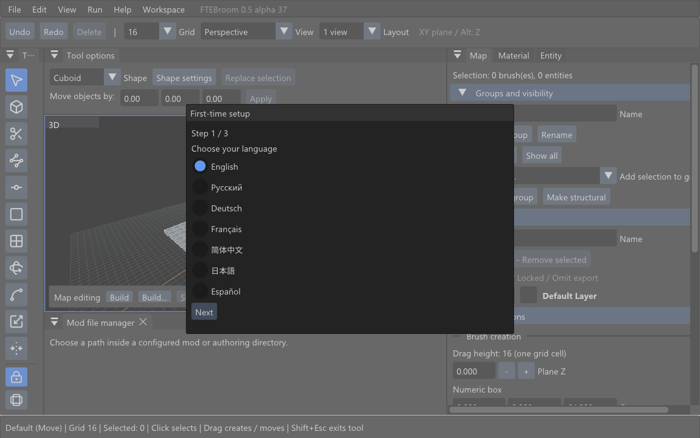
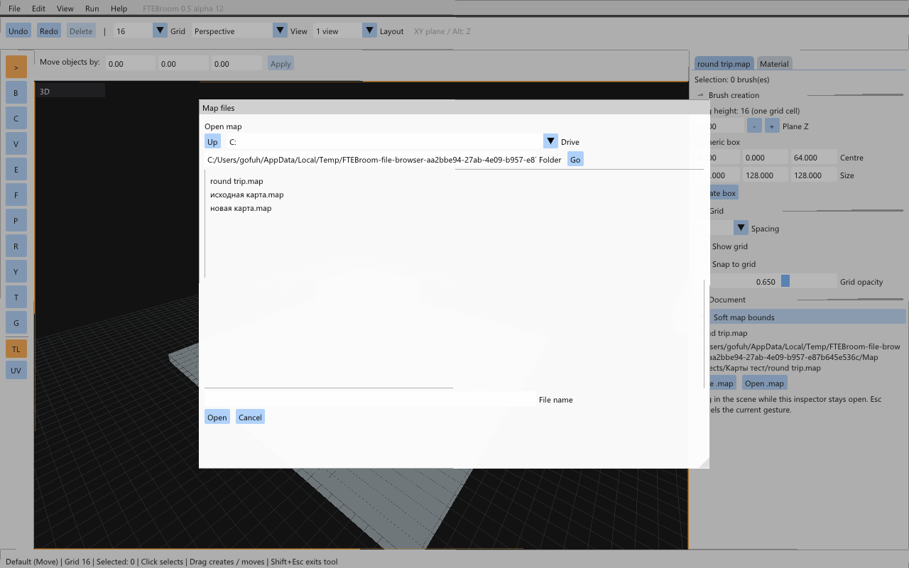
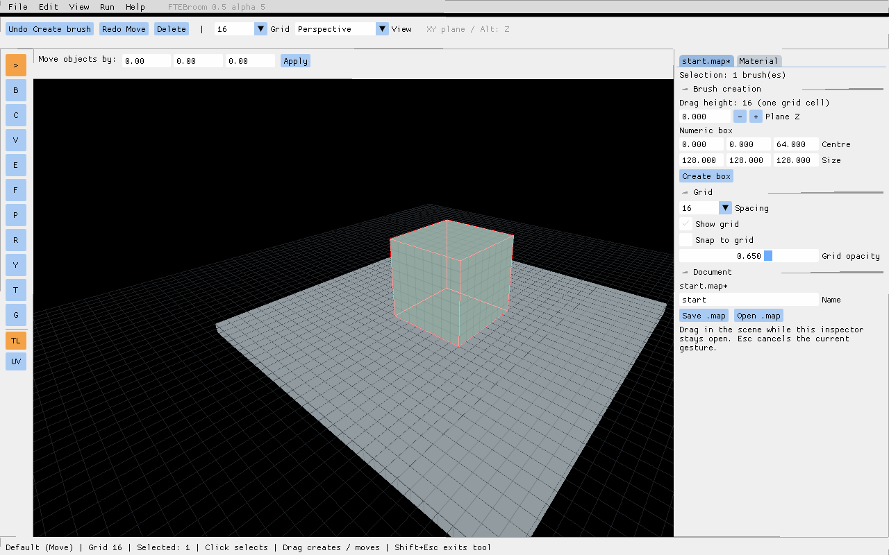
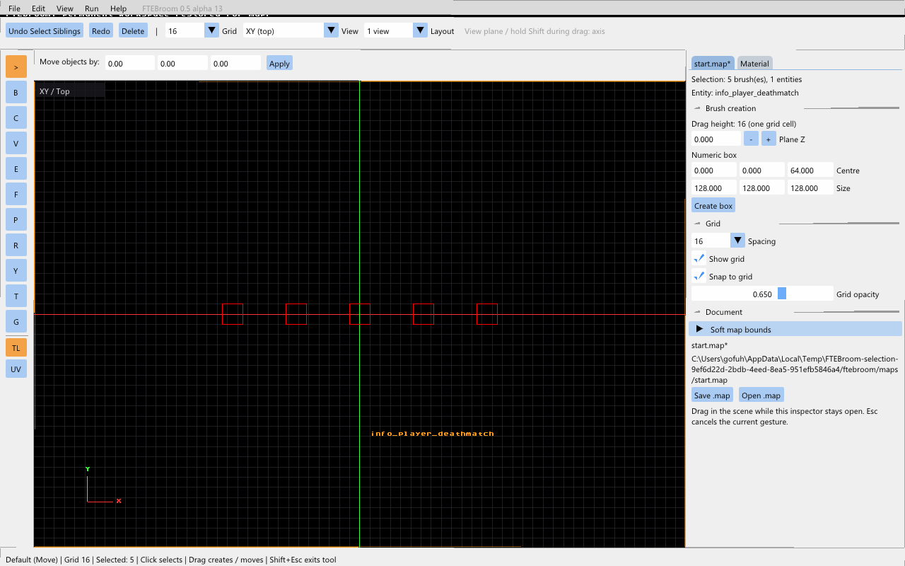
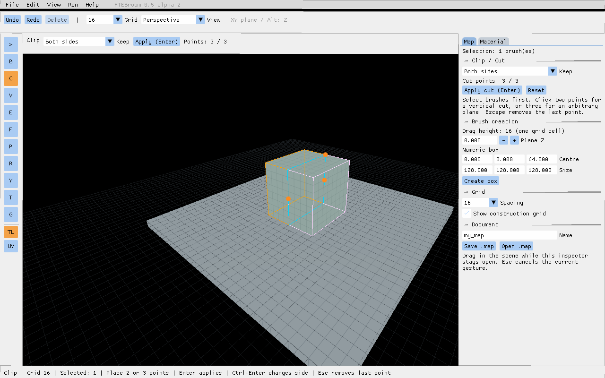
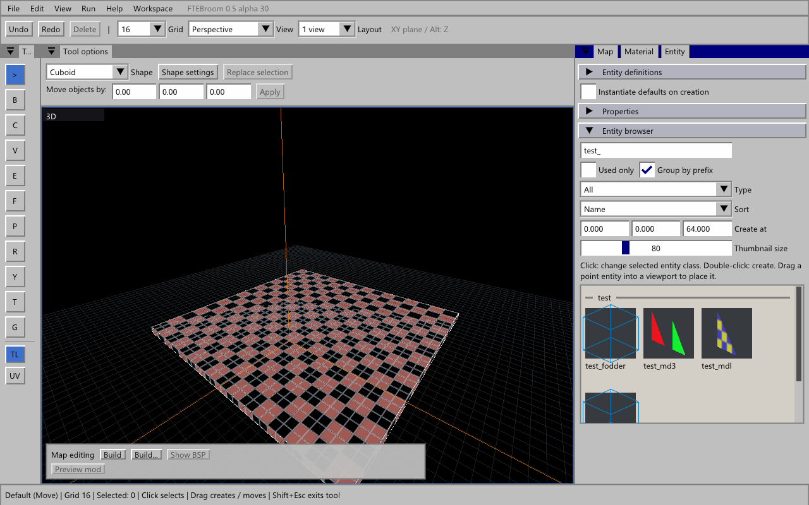
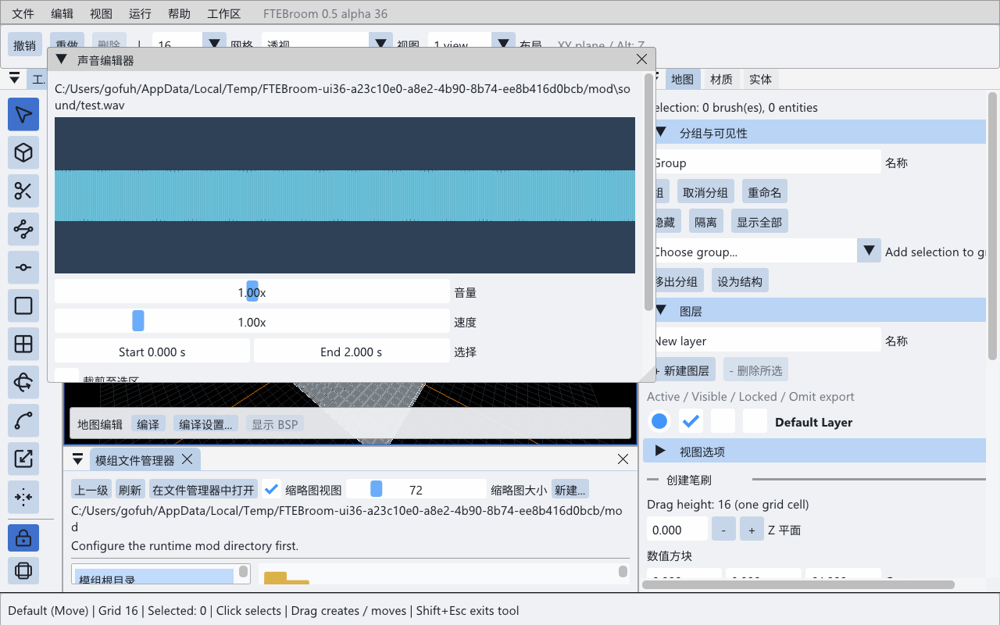
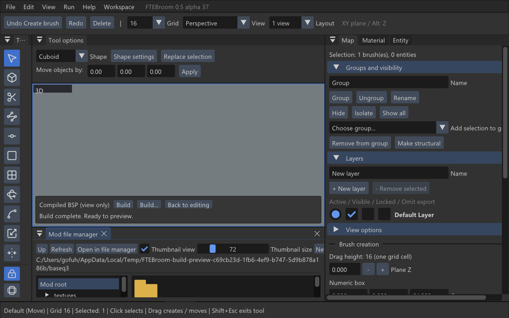
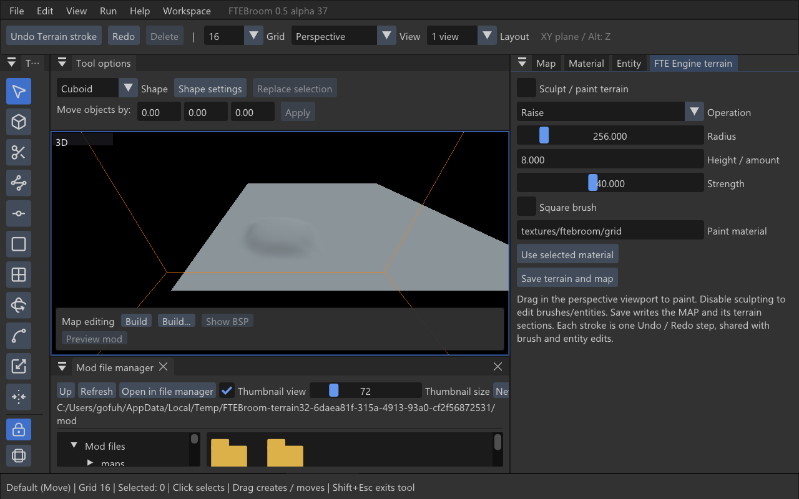

# Руководство FTEBroom

[English](manual.md) · [Горячие клавиши](shortcuts.md)

Это руководство описывает доступные инструменты и рабочие процессы. Иллюстрации
сняты в редакторе; на старых снимках отдельные названия и расположение панелей
могут отличаться. Игровые ресурсы не входят в поставку.

## Установка, первый запуск и профили

Распакуйте дистрибутив полностью в доступную для записи папку. В Windows запустите
`Launch-FTEBroom.cmd`. Откроется развёрнутое обычное окно с рамкой. Не отделяйте
исполняемый файл от папок ресурсов, шрифтов и компиляторов.

При первом запуске мастер последовательно предлагает язык, игровой профиль и
пути к ресурсам. Завершите настройку кнопкой **Load resources and start**.
При ошибке пути исправьте его в том же окне. Настроенные установки сохраняют пути
и повторно не показывают мастер. Язык затем меняется через **View → Language**.

**Quake III Arena:** укажите `baseq3` с PK3, текстурами или скриптами шейдеров.
Доступны материалы Quake 3 и патчи.

**Quake 1:** укажите `id1`/папку ресурсов или скачайте LibreQuake и включите
**Use LibreQuake mod**. Отдельный мод, дополнительные WAD2 и свои определения
энтити необязательны. Поддерживаются Standard/Valve 220 MAP и BSP29/BSP2.
Материалы берутся из WAD; патчей в этом профиле нет.
[Подробнее о Quake 1](quake1.ru.md), [LibreQuake и PAK](alpha29.ru.md).

**FTE Custom game:** папка исходников/ресурсов Quake 3 отделена от папки мода.
Папка мода нужна для **Preview mod**, но не для рисования брашей и обычной
сборки BSP. DEF/FGD или папка QuakeC с описаниями классов расширяют браузер энтити;
это необязательные поля. Старые карты с идентификатором
`when-the-sky-went-dark` продолжают открываться с этим профилем.

Смена профиля: **Edit → Preferences → Game profile → Switch profile**. Перед
закрытием изменённой карты редактор предлагает сохранить её. Затем появляется
стартовая сцена выбранной игры. При открытии MAP читаются заголовки FTEBroom
и поддерживаемые комментарии TrenchBroom. По одной геометрии игра не угадывается.

## Интерфейс и камера

Перетаскивайте вкладки, чтобы закреплять панели; границы и разделители меняют их
размер. Файловый менеджер по умолчанию расположен под центральным вьюпортом.
В Preferences доступны сброс раскладки, блокировка панелей и масштаб интерфейса;
по умолчанию 125%. **View → Interface theme**: Modern Dark, Modern Light,
Windows 95/98 и Windows 95/98 Dark. Настройки сохраняются между запусками.
Есть семь языков интерфейса; часть подсказок, сообщений движка и описаний игры
остаётся на исходном языке.

Выбирайте 1–4 вида и Perspective/XY/XZ/YZ на панели. Правая кнопка мыши вращает
камеру; WASD перемещают её, Q/X — вертикально, Shift ускоряет. Настройки камеры
задают поведение навигации. Доступны орбита, панорамирование, сохранённые точки
обзора и связанные ортографические виды. Ввод текста в поле не двигает камеру.

## Карты, сохранение и восстановление

**File → New** предлагает игру и место для новой карты. **Open / Save As** открывают
навигацию: клик по папке входит внутрь, **Up** возвращает на уровень выше. Для
сохранённой карты используется её папка, для новой — `maps` авторских ресурсов.
Двойной клик по MAP в файловом менеджере открывает карту через ту же проверку
несохранённых изменений: **Save / Don't Save / Cancel**. Отмена или ошибка
сохранения не закрывают текущую карту.

Стартовый список содержит название карты и последний профиль в одной строке.
Звезда добавляет карту в избранное; фильтр со звездой оставляет только избранное.
Недоступные файлы остаются в списке, но открыть их нельзя.

Ctrl+Z/Ctrl+Y отменяют и повторяют операции. Escape отменяет текущий жест.
Автосохранение и ротация резервных копий находятся в **Preferences → Backups**.
Сначала открывайте восстановленную копию отдельно. Если обработчик краша успел
сработать, диагностический отчёт помогает искать ошибку, но не заменяет автосохранение.

## Сетка, выделение и перемещение

Размер сетки — от 0,125 до 256 единиц. Колесо меняет размер; в настройках можно
выбрать вариант с модификаторами. Видимость, яркость и привязка настраиваются
отдельно. **View → Grid → Grid rotation** поворачивает сетку XY вокруг Z с шагом
один градус. Можно ввести целое значение. **Reset grid rotation** возвращает ноль.
Угол сохраняется, влияет на привязку и новые формы в перспективе/виде XY.
В боковых видах сохраняется рабочая плоскость.

Клик выделяет объект; перетаскивание выделенного двигает его в XY, Alt ограничивает
движение осью Z. В перспективе близкий объект проходит меньше мировых единиц
при одинаковом движении мыши. Для вершин действует тот же принцип.
При перемещении исходный браш скрыт до завершения; при дублировании он остаётся.
Ctrl-перетаскивание и Ctrl+D дублируют; Delete/Backspace удаляют.
Shift-клик выбирает грань; при наведении с Shift её контур жёлтый.

Команды выделения: All, Invert, Siblings, Touching, Inside, Tall и по строке MAP.
Выбор по глубине помогает с перекрывающимися объектами. Учитываются скрытие,
блокировки и фильтры. Направляющие от выделения останавливаются на видимых
невыделенных брашах и отмечают касание красным; патчи и модели их не останавливают.

## Создание и изменение геометрии

Без выделения протяните по пустому месту стандартным инструментом: получится
бокс высотой в одну ячейку. В Tool options выбираются форма и параметры.
Есть цилиндры, конусы, полые цилиндры, сферы, лестницы, арки, спандрели и окружности.
Составные формы редактируются как группы брашей.

**Rotate (R)** вращает выделение; можно менять центр и шаг угла. Есть поворот
с клавиатуры и отражение. **Scale / Shear** меняют размеры и наклон.
Texture lock управляет сохранением привязки текстур при трансформации.

**Vertex (V), Edge (E), Face:** выберите ручки и тяните их; Alt задаёт вертикальное
движение. Невыпуклый или невалидный результат отвергается. В 2D скрытая координата
не меняется. У одного выпуклого браша может быть не больше 64 граней.

**Extrude:** Shift-перетаскивание грани выделенного браша или ребра его силуэта.
Shift+Ctrl разделяет, Shift+Ctrl+Alt создаёт штамп. До отпускания виден результат;
Escape отменяет. Выбор за ребро силуэта помогает без точного наведения на грань.

**Clip (C):** поставьте две точки для зависимой от вида плоскости или три для явной
плоскости. Точки можно передвигать. Отсекаемая часть полупрозрачна. Выберите режим
сохранения стороны и Apply; Ctrl+Enter вызывает действие разрезания. Двойной клик
по грани берёт её плоскость. Undo возвращает исходные браши.

**CSG:** Merge объединяет, когда возможен выпуклый результат; Subtract вычитает
режущие объёмы; Intersect оставляет пересечение; Hollow создаёт оболочку.
**Sweep** строит Straight/Arc/S-bend с торцами, сужением, итерациями и предпросмотром.
**Repeat** повторяет последовательность команд для текущего выделения.
[Подробности и ограничения геометрии](alpha21.ru.md).

## Bevel и генератор рельефа

**Edit → Bevel:** скругление целого браша, внешнего контура выбранных граней,
рёбер E или вершин V. Настраиваются радиус, число сегментов и профиль: 0 — плоский,
0,5 — круглый, близко к 1 — квадратный. Clamp ограничивает пересечение скруглений
внутри каждого браша. Preview показывает результат в сцене; Apply применяет,
Cancel отменяет. При превышении 64 граней уменьшите число сегментов/рёбер.

**Edit → Terrain generator:** создаёт выпуклые ячейки из выделенных брашей или
меняет выделенные патчи. Параметры: U/V, высота, интенсивность, частота, шероховатость,
seed и ось/сторона. По умолчанию ячейки треугольные. Для браша берётся его bounding
box: исходная сложная топология не сохраняется. У патча нечётное число точек 3–31;
уменьшение сетки приближает поверхность. Есть Preview/Apply/Cancel и одна операция
Undo. Максимум 2048 выходных брашей. Это другой инструмент, не FTE Engine terrain.

## Патчи и UV

В Quake 3 и FTE Custom game создайте патч командой преобразования грани/создания
патча. Выделите его и используйте **Control Point (P)**. Передвигайте контрольные
точки; сетку можно разбить или изменить генератором рельефа. На патч назначаются
материалы и параметры текстуры. В Quake 1 патчи и P недоступны.

Графический UV-редактор позволяет менять смещение, масштаб, угол и shear,
центр преобразования, привязку и подразделения. Выберите грань и редактируйте
ручки/поля UV. Undo восстанавливает предыдущую развёртку.
[Патчи и UV подробнее](alpha21.ru.md).

## Материалы и WAD

Клик по материалу назначает его выбранным брашам/граням/патчу. Без выделения задаёт
материал следующего браша. Доступны смещения, scale X/Y, угол и атрибуты поверхности.
Отрицательный ненулевой scale зеркалит текстуру. Используйте Alignment, Fit
и перенос mapping с другой грани.

Поиск сочетается с коллекциями, использованными материалами и сортировкой по
использованию. У списка коллекций свой поиск. **Advanced search** фильтрует по
минимальной/максимальной ширине и высоте: 0 отключает границу, одинаковые значения
задают точный размер. Для шейдера берётся размер картинки предпросмотра.
Разделитель над браузером меняет его высоту; Thumbnail size — размер ячейки.

В Quake 1 добавляйте WAD через **Add WAD(s)** или drag-and-drop. При переносе
изображения на браузер выберите WAD и имя текстуры. Импорт адаптирует размер
и палитру, сохраняя резервную копию изменяемого WAD. Перед компиляцией загруженные
WAD копируются в папку задания под ASCII-именами, в том числе из путей с кириллицей.
Просто положить WAD рядом с MAP недостаточно: сначала загрузите его в Material.

## Энтити, группы и слои

Браузер использует определения ENT/DEF/FGD выбранного профиля. Перетащите ячейку
в сцену для создания. При выделенном энтити выбор другого класса меняет его класс.
В Entity редактируются свойства, значения по умолчанию, флаги и цвета.
Модели и их материалы должны присутствовать в загруженных ресурсах. Браузер
не исполняет `progs.dat` ради автоматического обнаружения любой логики спавна.

Выделенные браши можно преобразовать в брашевый энтити. Группы организуют объекты,
слои управляют видимостью/блокировкой. Есть Hide/Isolate/Show All и фильтры по
классу/тегам. View включает названия классов и рамки разных типов объектов.
Линии target/killtarget показывают связи. Omit from export исключает элементы
из итоговой экспортируемой карты.

Linked groups синхронизируют экземпляры с учётом относительных преобразований;
защищённые свойства энтити допускают различия экземпляров. Separate/Extract
делают экземпляр независимым. [Подробности](alpha21.ru.md).

## Файловый менеджер, модели и звук

Панель открывается из Workspace. Есть дерево, плитки/список, размер ячеек,
Up, Refresh и открытие папки в системном проводнике. У **FTE Custom game** два корня:
**Mod files** и **Map sources / authoring assets**. Для `id1`/`baseq3` это отдельные
ветки. Переключение не меняет папку мода для игрового запуска.

Контекстное меню файла: Copy/Cut/Paste/Rename и редактирование текста.
Внешние файлы копируются. Модель, брошенная в сцену, копируется в мод и становится
`func_model`. PAK выглядит как папка с полоской архива; его можно открыть,
импортировать/заменять и переименовывать записи. Запись сохраняет backup.
Cut между PAK и диском и копирование целых упакованных папок не поддерживаются;
используйте Copy для извлечения/импорта. [Подробности PAK](alpha34.ru.md).

Двойной клик по модели открывает **Model viewer**. Левая кнопка вращает орбиту,
колесо меняет расстояние. Выберите анимацию, запустите её или двигайте ползунок
кадра; настройте FPS. Кости доступны у скелетных моделей. У обычных MDL/MD3
вершинная анимация и скелетных костей нет. Игровые события просмотрщик не исполняет.

Двойной клик WAV/OGG/MP3/FLAC открывает **Sound editor** с волной. Выберите диапазон,
громкость, скорость и проиграйте результат. **Trim to selection** оставляет диапазон.
**Save with backup заменяет исходный файл**, включая запись в PAK. Скорость меняет
и высоту тона. Обработка — stereo 44,1 кГц; WAV сохраняет исходные число каналов
и частоту, сжатые форматы перекодируются. Loop/cue-метки не сохраняются: оставьте
backup, если они нужны игровому звуку.

## Компиляция и предпросмотр

Сохраните карту. **Build...** задаёт компилятор, стадии Geometry/BSP, VIS, LIGHT
и дополнительные аргументы. **Build** запускает сохранённую конфигурацию сразу.
Задание использует копию карты в `_ftebroom-build` рядом с исходником.
Над вьюпортом отображаются стадия/статус, полный вывод записывается в лог.
Cancel сохраняет предыдущий успешный BSP.

После успешной сборки по умолчанию открывается **Compiled BSP (view only)**.
**Back to editing** возвращает MAP. Мод автоматически не запускается.
**Open mod preview after Build** включает это отдельно; прежнее неявное включение
при обновлении сбрасывается. VIS/LIGHT без Geometry требуют предыдущий BSP
с тем же экспортированным содержимым карты.

**Preview mod** запускает ресурсы и код настроенного мода. Выберите Free camera
или Play mod; Escape освобождает мышь, Back to editing возвращает редактирование.
Нужен совместимый мод с ресурсами. Авторская библиотека текстур автоматически
не переносится в мод. Эффекты могут различаться в MAP, BSP и реальной игре.

Run/task profiles позволяют настроить экспорт, компиляторы и запуск, Stop/Rerun.
Есть экспорт MAP и OBJ/MTL. Issues проверяет проблемы и предлагает исправления;
leak paths и порталы помогают разбирать результат компиляции.
Для первого теста сделайте закрытую комнату с точкой старта игрока.

## FTE Engine terrain

Только **FTE Custom game**: **Edit → Create FTE Engine terrain** или контекстное
**Create FTE Engine terrain here**. Укажите origin и материал, затем Add.
На текущую карту добавится участок 2×2 секции. Панель FTE Engine terrain даёт
поднятие/опускание, сглаживание, flatten, покраску, воду и отверстия, радиус,
силу и величину кисти.

Создание и каждый законченный мазок поддерживают Undo/Redo. Выход из панели,
смена инструмента или Exit terrain editing освобождают кисть. MAP и папку секций
нужно переносить вместе; Save As копирует секции. Это heightfield FTE, не патч
и не набор BSP-брашей. Q3Map2 его не компилирует; обычный Build для таких документов
отключён. В Quake 1 и Quake 3 создать его нельзя.

## Обновление и ограничения

В Windows **Help → Updates** проверяет релизы, скачивает проверенный пакет и
устанавливает после нормального выхода. Настройки/карты сохраняются, rollback
остаётся в `updates`. [Подробнее](alpha30.ru.md). Linux пока обновляется вручную.

Актуальные привязки смотрите в Preferences → Keyboard и [справочнике](shortcuts.md).
F1–F12 не назначаются действиям редактора. Учитывайте лимит 64 граней, стоимость
сложных моделей/предпросмотров, неполный перевод и отсутствие сохранения loop/cue.
Для сообщения об ошибке приложите версию, профиль, режим MAP/BSP/mod, шаги и лог.

## Unity Sync

**Tools → Unity Sync** экспортирует браши, патчи, UV и статичные изображения материалов в Unity-проект. Доступны отдельные объекты/общий меш, коллайдеры и масштаб. [Описание и проверки](alpha51.ru.md).
