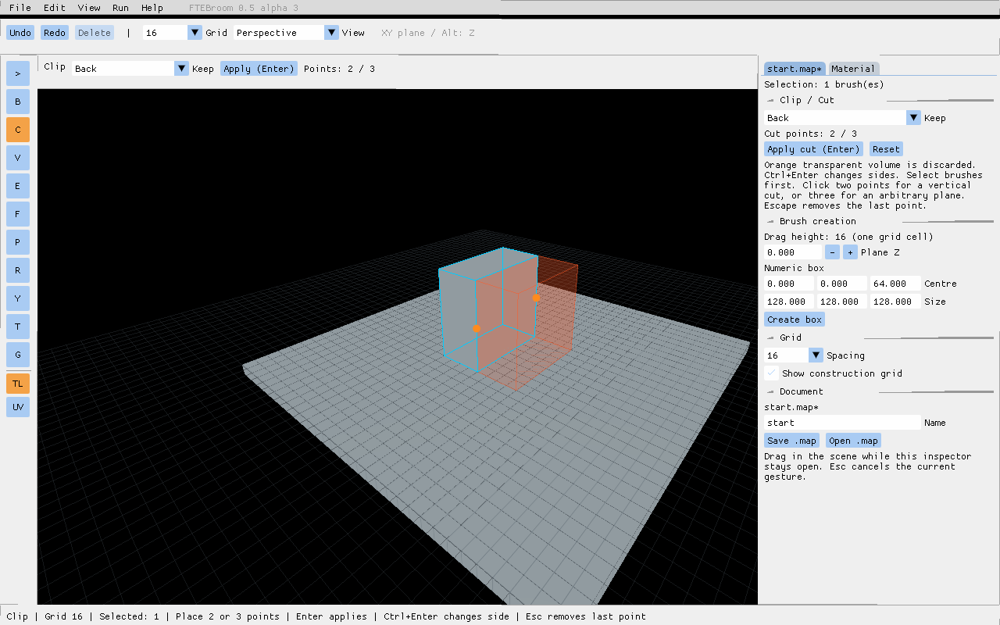
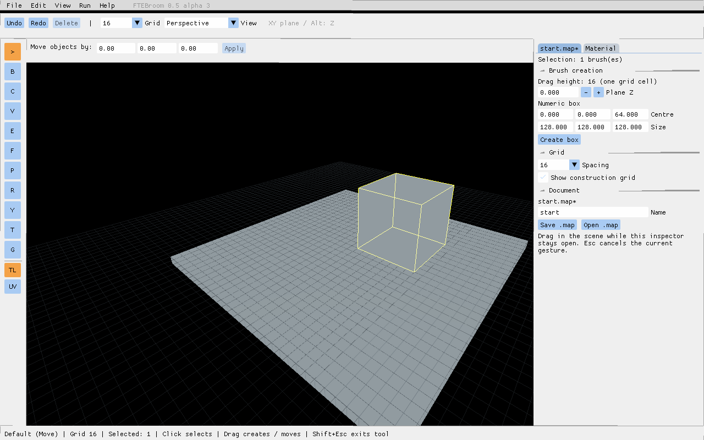
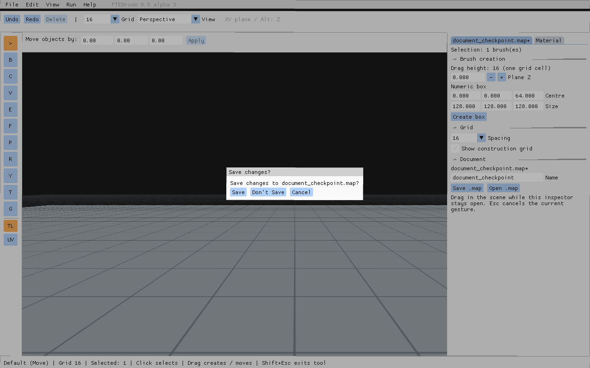

# Document model and preview corrections — 0.5.0-alpha.3

## Visible changes

- Clip displays the discarded volume in transparent orange. The retained volume is opaque with a cyan outline. Ctrl+Enter cycles Both / Front / Back; Enter applies. In Both mode neither half is discarded. A missing, tangent or invalid cut leaves the source visible.
- Moving a brush replaces its original rendering with the moving preview. Escape restores the original without editing the MAP.
- The Document inspector shows the current name and an asterisk for unsaved history changes. Saving, undoing back to the save checkpoint and redoing update this state.
- File New, Open, Close and Exit protect dirty documents with Save / Don't Save / Cancel. The engine's normal quit command and window close request also go through the editor. Force quit and process termination cannot be protected.
- New and Close start a fresh empty document. Save uses the Name field in the inspector. Names contain letters, digits, underscores and hyphens; paths and extensions are not entered there.
- Saves use a unique engine export followed by an atomic replacement. A failed write keeps the document dirty and reports an error.
- Automatic backup defaults to 10 minutes (`ftebroom_autosave_interval`, zero disables it). Each named map retains up to 50 slots in `ftebroom/autosave/`; the oldest slot is replaced. Backups do not mark a document saved. Copy a backup into `ftebroom/maps/` to open it through the inspector.

## Data model

The QC node tree contains world, default/named layers, groups, entities, brushes and patches. It resolves `_tb_group` and `_tb_layer` references after reading all entities, so file order does not matter. Entity nodes retain their entity-lump index and metadata. Brush and patch nodes reference `(model, id)`; Undo resurrection remaps IDs. History revisions are unique even after branching from an undo checkpoint.

This is the document foundation, not a new layer/group management interface. Imported hidden/locked flags are stored in nodes; enforcing them in every tool and editing entity fields through transactional history remain subsequent work. Direct legacy console mutations outside history do not update the dirty checkpoint. Use the editor's file controls for guarded document replacement; raw `mapedit` deliberately remains an engine command.

## Verification and acceptance

Automated tests load a synthetic asset-free MAP containing a named layer, group, brush entity, point entity and Quake 3 patch. They compare entity keys, brush face records, object ownership, patch dimensions/control points/UVs, save checkpoints, Undo/Redo, editing after Undo, and autosaves. FTE normalizes unused patch header fields; the test does not claim byte-identical patch formatting.

Run `scripts/test-document-windows.ps1 -Bundle <disposable bundle>` and repeat with `-Case preview` and `-Case document-files`. Existing editing, gesture, action and tool tests remain required. Preview screenshots must also be inspected: transparency is a rendering property, not established by MAP equality alone.

Please test:
1. Select a box, press C, place two cut points, cycle Ctrl+Enter and apply. Confirm the transparent side disappears.
2. Drag a selected brush: only its moving preview should remain. Press Escape and check that the original returns.
3. Save, move, Undo, Redo and watch the asterisk beside the document name.
4. With unsaved edits, try File New/Open/Close/Exit and the window close button. Test Cancel first, then Save using a disposable map.

