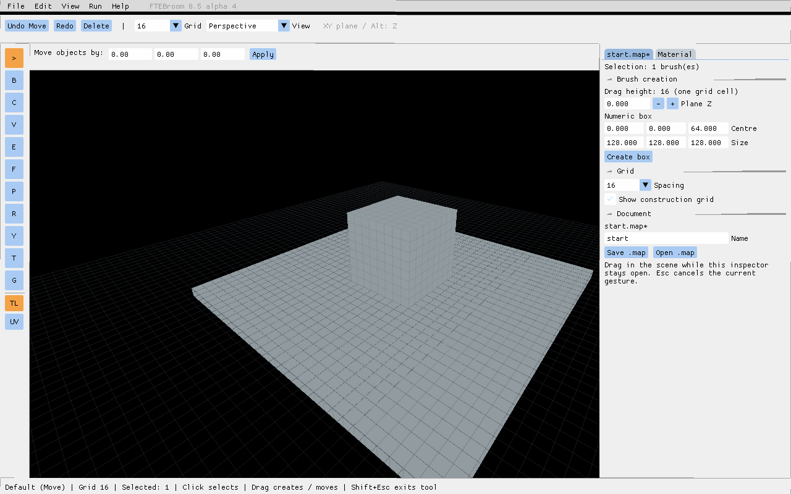

# Transaction history and Delete — 0.5.0-alpha.4

[Русский](task-0.4.ru.md)

## Using this preview

- **Del** deletes the selected whole brushes in the default and Brush tools. In Clip, Del removes the last cut point when one exists; otherwise it deletes the brush selection. Text inputs and popups consume their own keyboard input.
- **Ctrl+Z / Ctrl+Y** restore geometry and the selection before/after an operation. Selecting A and then B is undoable.
- Arrow keys move selected brushes along world X/Y; Page Up/Down use Z. Each step equals the current grid size. Five presses less than one second apart form one Undo operation. A longer pause starts another operation.
- Edit and toolbar Undo/Redo buttons show the action name.
- `ftebroom_undo_levels` defaults to 512 transactions, not 512 individual brush records. Old transactions are evicted whole.
- `ftebroom_undo_collate_time` defaults to one second. Collation requires the same repeatable action and targets; Undo, Redo and a saved checkpoint break the sequence.

The Delete bug involved both tool contexts and a QuakeC legacy-target 64-bit mask comparison: a whole-brush selection was classified as a face selection. Whole-brush detection now compares the two 32-bit words explicitly.

## Transaction API

`fb_tx_begin(name)`, `fb_tx_commit()` and `fb_tx_cancel()` wrap box creation, movement, deletion, Clip, material and UV edits. Nested begin/commit pairs belong to the outer transaction. Cancel rolls back the complete outer transaction and restores its previous redo branch.

Selection records retain brush model, ID and face mask before/after, plus the existing single entity-selection index. Geometry resurrection remaps selection and document references. Entity-field, node-flag and tree-membership snapshots use separate record kinds; `fb_tx_set_key` provides an undoable field update. Tests exercise a door property, a layer's hidden flag and group membership.

This stage supplies history infrastructure for layer/group editing. Their management UI, multi-entity selection, rotation and keyboard UV nudges remain later roadmap work. The collation API recognizes those future repeatable operation names.

## Verification

Run `scripts/test-history-windows.ps1 -Bundle <bundle> -Python <python>` and repeat with `-Case history-stress`. Tests use disposable installations and synthetic maps:

- Native Del dispatch in default, Brush and empty Clip modes; text/popup protection; Undo/Redo and multiple-brush deletion.
- A → B → Undo A → Undo empty selection.
- Five nudges at 0.2-second intervals versus 1.5-second intervals.
- Three edits with nested transactions, cancellation and byte-identical exported MAP; redo branch preserved.
- Whole-transaction eviction and allocator growth with 600 synthetic selection records plus a real geometry edit.
- Entity, layer flag and group-parent restoration.

FTE's internal brush-edit message queue can overflow if hundreds of geometry edits are executed synchronously in one frame. This preview does not remove that engine limitation; the allocator stress test deliberately isolates history growth from network throughput. Normal editing and the tested small multi-brush operations do not reproduce it.

Please test Del on several selected brushes, Undo/Redo, selecting two different brushes then Undo, and five quick arrow presses followed by one Undo. Check that typing in an inspector field never deletes geometry.

