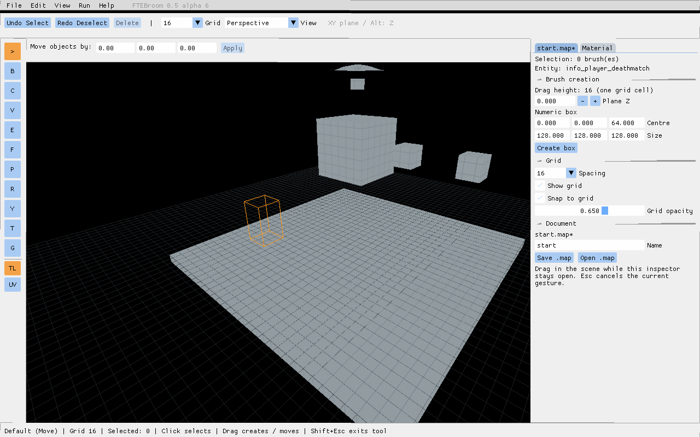

# Выбор объектов под курсором — 0.5.0-alpha.6

[English](task-0.6.md)

## Что изменилось

- Клик в сцене и расстановка Clip-точек используют новый механизм выбора. В перспективе выбирается ближайшая доступная поверхность.
- В 2D перекрывающиеся браши сравниваются по площади проекции грани под курсором. Можно выбрать маленький браш внутри большого.
- Патчи выбираются по треугольникам изогнутой поверхности. Перемещение патчей и редактирование контрольных точек остаются следующими задачами.
- У точечных сущностей показаны рамки. Клик выделяет сущность, подсвечивает рамку и выводит имя в инспекторе; Undo восстанавливает выделение. Редактор свойств и перемещение сущностей пока не добавляются.
- Запрос выбора исключает скрытые и заблокированные узлы, включая потомков таких групп и слоёв. Это фильтр выбора; полное управление слоями и применение этих ограничений ко всем командам — отдельные этапы.

## Основа для следующих инструментов

Запрос возвращает список попаданий: тип объекта, модель, ID, грань, расстояние, точку и нормаль. Для брашей проверяются границы и плоскости выпуклого объёма; для патчей — треугольники рассчитанной поверхности.

Точечные сущности выбираются по габаритам класса из csaddon с учётом origin. Для неизвестных классов используется существующая рамка ±8 единиц. Это выбор по габаритам, а не по треугольникам модели сущности.

Добавлен API регистрации до 256 ручек с радиусом по умолчанию шесть пикселей и приоритетом над геометрией. Есть поиск обратной грани возле ребра выделенного браша на расстоянии до восьми пикселей — для будущего Extrude. Сами манипуляторы Rotate/Scale/Vertex, Extrude и переключение объектов в глубине этим этапом не добавляются.

Пространственного индекса пока нет: перебираются узлы документа с предварительной проверкой габаритов. Производительность на очень больших картах ещё нужно проверить.

## Проверка

Автотесты проверяют три браша по лучу, расстояния, скрытие и блокировку родителя, ручки, патчи, сущности, обратные грани около рёбер, обычные клики, Undo выделения и выбор меньшего браша в 2D. Экспорт MAP до и после запросов должен совпадать побитово.

Проверьте обычный выбор и Shift+клик по грани, перемещение и Clip; маленький браш на фоне большого в 2D; выбор изогнутого патча; выбор рамки сущности с отображением имени и Undo.

## Вид в редакторе

Escape снимает выделение сущности; Undo возвращает его. Автоматическая проверка включает 25 условий выбора и сохранение MAP без изменения содержимого.

