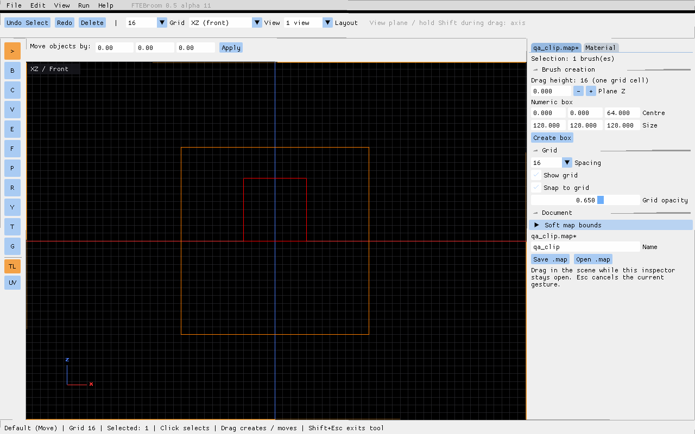

# View-aware gestures and faster surface grids — 0.5.0-alpha.11
[Full combined checklist](checks-1.4.md)

Brush gestures and modal pointer routing now receive an explicit view. A gesture captures its starting plane; events from another view cannot redirect it. Clip retains the first point's view for its cut-plane calculation.

In XY, XZ and YZ, creation and movement stay in the displayed plane. The hidden coordinate is unchanged during movement. New brushes inherit the last selection's depth and thickness, including fractional thickness; without a previous selection, thickness is one grid cell.

Alt is ignored throughout a 2D drag, including when pressed or released mid-gesture. In perspective, ordinary movement remains XY and Alt remains vertical Z.

Start dragging, then hold Shift to lock the dominant displayed axis. The chosen axis remains locked until Shift is released; releasing Shift restores unrestricted movement in the view plane. Shift+click still selects a face. Pressing Shift before mouse-down retains this face-selection behaviour.

3D surface-grid geometry is cached by document generation, model and camera region. Edits, Undo/Redo and map loads invalidate it. Projection-dependent spacing is recomputed only when the camera, viewport, FOV or grid spacing changes; opacity is applied immediately. The projected-density calculation uses three projections per face instead of an iterative search. Clip and drag previews still suppress the source brush's grid.

On this machine (RTX 4060 Laptop GPU, 1280×800, four panes, generated 2000-brush map), the initial stationary-camera measurement was about **94 FPS with grids**, versus approximately **30 FPS in alpha.10**; hidden grids measured about **209 FPS**. Camera movement still recomputes spacing and can be slower. These are local measurements, not a guarantee for every map or device. Reproduce with `tests/benchmark-layouts.cfg` and `tests/prepare-manual-fixtures.py --benchmark`.

Run `scripts/test-planes-windows.ps1` for explicit-view rejection, Alt/Shift constraints, complete exported movement bounds, Undo/Redo and grid cache validity after edits and map changes. Existing view tests cover fractional inherited depth, creation, projection and two-point Clip on all six box faces.

This stage does not implement the geometry of the placeholder modal tools. Focus-on-selection navigation is the next roadmap stage, 1.5. Earlier alpha.9/alpha.10 manual checks remain pending and are included in the combined checklist.

