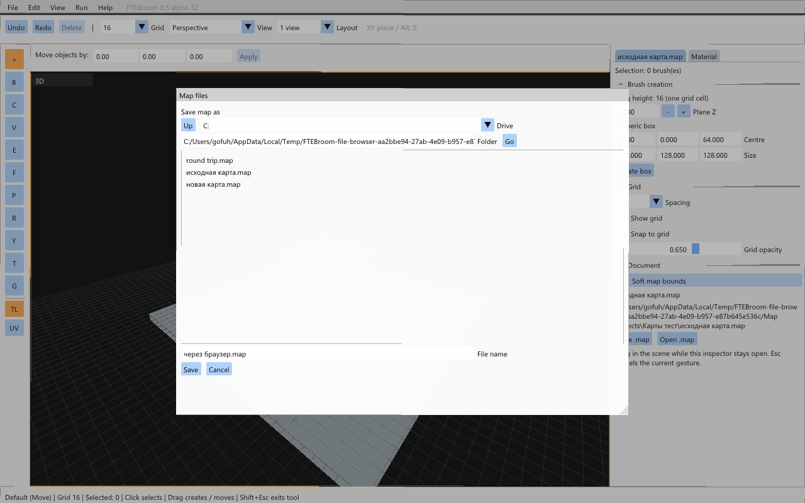
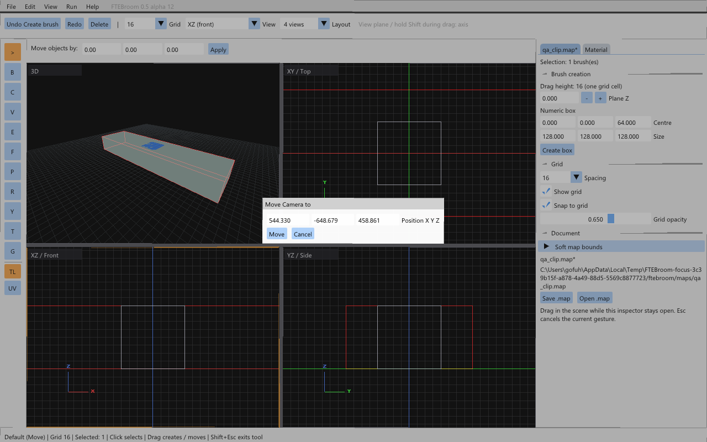

# File browsing and automatic navigation — 0.5.0-alpha.12
[Acceptance checklist](checks-1.5.md)

File → Open (Ctrl+O) opens an ImGui filesystem browser. Double-click folders, use Up, choose a Windows drive, or enter a folder path and press Go. Select a `.map` and press Open. The browser supports paths outside the editor installation, spaces and Cyrillic names. Windows uses its installed Segoe UI font to display those names; the font is not redistributed.

Save As (Ctrl+Shift+S) uses the same browser to choose a folder and file name. Missing `.map` extensions are added. Replacing an existing file requires confirmation. Save (Ctrl+S) writes the current file; a new untitled document opens the browser. Cancel leaves the current document unchanged. Unsaved-change protection remains active when opening another map.

FTE reads a generated local staging alias, while the frontend retains the original full path. User paths are never interpolated into engine commands. Saves are serialized by FTE, copied to a temporary file beside the chosen destination and replaced atomically. The document's save checkpoint and destination change only after successful replacement. Autosaves remain in the editor's autosave directory.

Ctrl+U focuses the perspective camera on the current selection without changing its angles. A bounding sphere and the actual viewport's narrower field of view determine the distance. A 150 ms smooth animation moves the camera and centers all orthographic views on the selection. The 2D zoom is retained. Manual camera input interrupts the animation. With no selection, the command does nothing.

View → Move Camera to… accepts X/Y/Z coordinates within ±65536 and moves the perspective camera without changing the 2D centers or view angles. Neither operation changes MAP data or Undo history.

Point-file loading belongs to roadmap 20.3. Next/previous point navigation remains unavailable until that loader exists. This release does not claim that dependency is implemented.

The previous alpha.11 stage was accepted by the user. Automated checks cover external Unicode/space paths, preservation of the original, subsequent Save targeting, brush/entity/patch round-trips, failed-save checkpoints, filesystem navigation and Save UI, all eight projected bounding-box corners, animation, unchanged angles/history, and explicit camera positioning.

