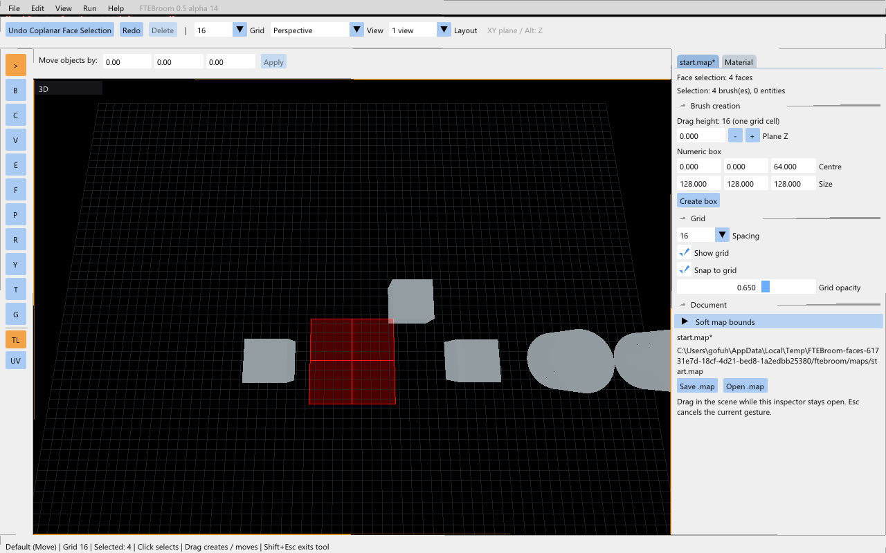

# Task 2.2 — face selection

[Русский](task-2.2.ru.md) · [Combined checks](checks-2.2.md)

Windows preview **0.5.0-alpha.14** adds face selection in the perspective view.

| Gesture | Result |
| --- | --- |
| Shift+click | Replace selection with one face |
| Ctrl+Shift+click | Toggle a face |
| Shift+double-click | Select all faces of the clicked brush |
| Ctrl+Shift+double-click | Add all faces of that brush |
| Shift+Alt+double-click | Select connected coplanar faces |
| Ctrl+Shift+Alt+double-click | Add the connected coplanar region |
| Ctrl+Shift+drag | Paint faces, when at least one face was already selected |
| Ctrl+Shift+A / empty click | Clear selection |

Ctrl+Shift+click on a selected whole brush converts the selected brushes to faces and removes the clicked face. Clicking an unselected brush with that gesture starts a new face selection. Object selection and face selection are separate states. Material, scale and angle changes affect selected faces; a selected whole brush still applies them to every face.

Paint is one Undo step; Escape restores the previous selection and preserves the redo branch. Selection changes do not modify MAP geometry. Selected faces have a red translucent fill and outline; the inspector reports the face count.

Coplanar flood uses matching planes and a breadth-first search through shared edge segments or positive-area polygon overlap. Gaps, point-only contact, different planes, hidden objects and locked objects are excluded. It aborts without changing selection if more than 4096 coplanar candidates are encountered. Face indices 0–63 are supported; attempts to select later faces show a status message. Selecting all faces on a larger brush selects its first 64 faces and shows the same limit. Face gestures are 3D-only. Full selection rendering refinements belong to task 2.3.

The engine multicast scratch buffer now accommodates a complete brush edit instead of being limited to two small network packets. Regression coverage includes 64/65-face brushes and material Undo. This is not a claim of networked collaborative editing support.

Run **Launch-Checks.cmd → 9** for the prepared face scene. Alpha.12 and alpha.13 remain pending manual acceptance; alpha.11 was accepted.

