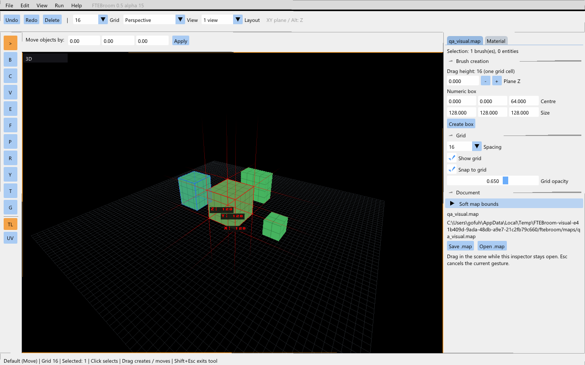
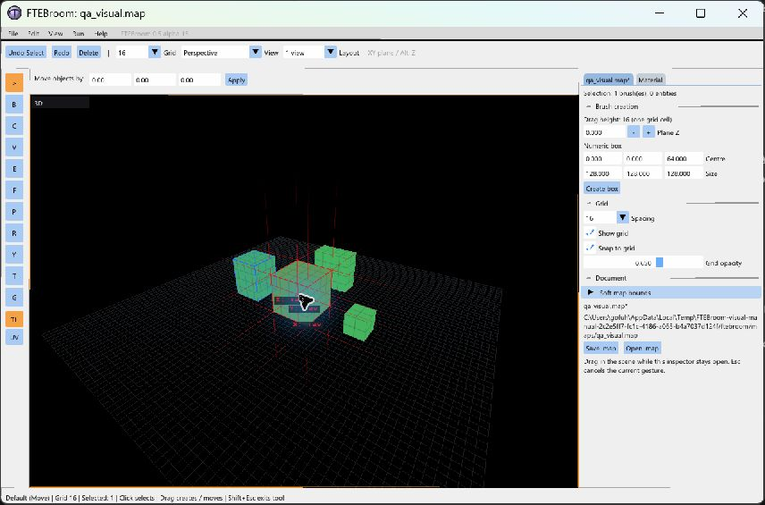
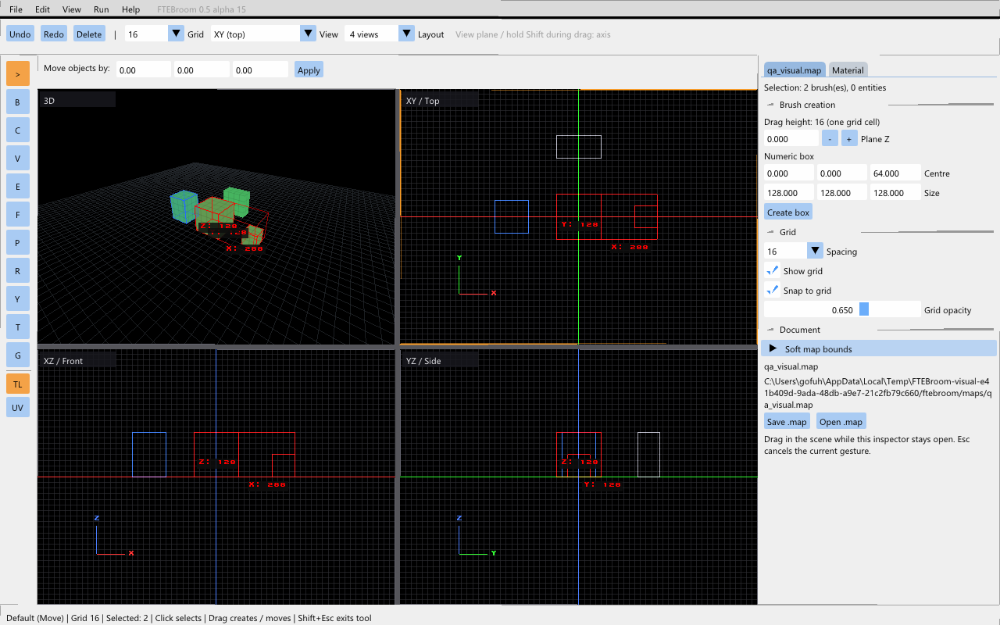

# Task 2.3 — selection and hover rendering

[Русский](task-2.3.ru.md) · [Complete pending checklist](checks-2.3.md)

Windows preview **0.5.0-alpha.15** updates the viewport selection display:

- Selected brushes and patches retain their material, with light red tint and red edges. Occluded edges remain visible at lower opacity.
- Selected faces have a 30% red overlay and contour.
- The combined selection has a red bounding box and X/Y/Z dimensions in map units. Orthographic panes show the two dimensions in their plane, without surface fill. Face-only bounds follow the selected faces.
- Hovering a selected object in 3D shows 256-unit alignment guides extending outward from the bounding-box corners and fading toward their tips.
- Locked objects, including children of locked layers, have blue edges and a blue tint in 3D.
- Unselected hovered objects receive a light highlight. Hover and rendering never create history steps or modify the MAP.

**File → Preferences…** provides **Highlight hovered objects**, **Show selection dimensions**, and **Show alignment guides on hover**. Colours are RGB cvars: `ftebroom_color_selected "1 0 0"`, `ftebroom_color_locked "0.15 0.4 1"`, `ftebroom_color_hover "1 0.8 0.25"`.

The 2D view cache tracks hover, colours, face masks and lock state. Stationary hover picking is reused briefly; camera/pointer changes invalidate it. Existing move-preview replacement remains respected, so no selection overlay is left at the original brush position during a drag.

Run **Launch-Checks.cmd → A** for a ready scene with three editable green brushes and a reference brush in a locked layer. This stage does not add layer-management commands; the locked layer is already in the fixture.

Alpha.12–14 are still awaiting manual acceptance. Next roadmap task: 2.4, selection commands in the Edit menu.
